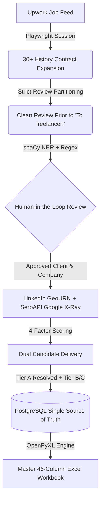

# Upwork Lead Discovery & LinkedIn Decision-Maker Identification Pipeline

An enterprise asynchronous pipeline and RESTful API that discovers high-value Upwork jobs, deep-scrapes 30+ past contract histories using strict review partitioning, extracts client identities via spaCy NER and linguistic dependency parsing, discovers executive decision-makers on LinkedIn via public Google X-Ray & native GeoURN resolution, scores candidates using a 4-factor ranking algorithm, and exports a sales-ready **Master 46-Column Excel Workbook**.

---

## User Quickstart Guide

For a complete step-by-step walkthrough on how to authenticate using the real-browser login script and use the web interface on port 8000 after cloning, see:
* [context/USER_QUICKSTART_GUIDE.md](context/USER_QUICKSTART_GUIDE.md)

---

## Key Architectural Capabilities

1. **Anti-Blocking Playwright Ingestion**:
   - Webdriver evasion, automated cookie detection, and jittered pacing (8–15s).
   - Interactive DOM expansion navigating `Jobs in progress` tabs and recursive `View more` pagination to extract 30–50+ past contracts per job.
2. **Strict Review Partitioning**:
   - Isolates text *strictly prior to* `"To freelancer:"`, quarantining client praise directed at freelancers into `excluded_client_praise` to eliminate false-positive entity extractions.
3. **spaCy NLP & Linguistic Intelligence**:
   - Zero hardcoded names in application code.
   - Combines spaCy NER (`PERSON`, `ORG`), syntactic dependency parsing, and linguistic regex anchors across all contracts to compute consensus confidence (e.g. 12 review confirmations -> 95% confidence).
4. **Human-in-the-Loop Review**:
   - Interactive approval checkpoint allowing users to confirm, edit, or override extracted client names and company entities before consuming external search credits.
5. **SerpAPI Google X-Ray & Native GeoURN Resolution**:
   - Maps city/metro, state, and country to LinkedIn native GeoURN codes (e.g. Winnipeg -> `90008587`, Canada -> `101174742`).
   - Prioritized search engine queries with MD5 disk caching to safeguard search credits.
6. **4-Factor Composite Decision-Maker Scoring & Dual Delivery**:
   - Weights: Name Match (40%), Location Alignment (35%), Role Authority (15%), Company Presence (10%).
   - Delivers both **Primary Resolved Candidate (Tier A)** and **Potential Candidates (Tier B & Tier C Runners-Up)**.
7. **Single Source of Truth Database**:
   - Fully asynchronous PostgreSQL via SQLAlchemy 2.0 and `asyncpg` (SQLite + `aiosqlite` for zero-dependency local runs).
   - Stage-by-stage JSON snapshots (`stage1_feed`, `stage2_jobs`, `stage3_nlp`, `stage4_leads`).
8. **Master 46-Column Excel Export Engine**:
   - Sales-ready `.xlsx` organized across 6 functional zones (Deal Economics, Competition, Client Credibility, Intelligence, Decision-Maker Outreach, Sales Pitch Hooks).
   - Raw, unmasked clickable hyperlinks compatible with Google Sheets, HubSpot, and Apollo.

---

## Architecture & 6 Functional Zones



### 46-Column Layout Summary (Cols A–AT):
- **Zone 1: Deal Economics (Cols A–I)**: Job Title, Job URL, Relative/ISO Dates, Pay Type, Rates ($Min/$Max), Duration, Experience Level.
- **Zone 2: Competition (Cols J–N)**: Proposals Tier, Interviewing Count, Invites Sent, Unanswered Invites, Last Activity.
- **Zone 3: Client Credibility (Cols O–Z)**: Verified Payment, Rating, Total Reviews, Lifetime Spend ($USD), Hire Rate (%), Total/Active Hires, Avg Hourly Rate ($), City, Country, Local Timezone, Member Since.
- **Zone 4: Extracted Intelligence (Cols AA–AI)**: Client First Name, Confidence %, Mention Count, Evidence Snippet, Company Name, Company Snippet, Is Agency, Agency Reason, Project Keywords.
- **Zone 5: Decision-Maker Outreach (Cols AJ–AQ)**: Decision Maker Name, Headline / Role, Location, Match Score (%), Tier Badge, LinkedIn Profile URL, Metro GeoURN Search Link, Country GeoURN Search Link.
- **Zone 6: Sales Hooks & Scope (Cols AR–AT)**: Skills Required, Full Job Description, Recommended Pitch Hook.

---

## Quick Start

### 1. Step 1: Real-Browser Login (Cloudflare Safe)
```bash
python3 scripts/interactive_login.py --user your_email@domain.com
```

### 2. Step 2: Start Services via Docker Compose
```bash
docker compose up -d
```
Access the dashboard on `http://localhost:8000`.

---

## API Endpoint Reference

| Method | Endpoint | Description |
| :--- | :--- | :--- |
| `GET` | `/health` | Service health and uptime status |
| `POST` | `/api/v1/auth/login` | Initializes bot-evasive Playwright authentication context |
| `GET` | `/api/v1/auth/status` | Verifies active Upwork session and cookie health |
| `POST` | `/api/v1/jobs/search` | Ingests job feed for query with anti-blocking pacing |
| `POST` | `/api/v1/jobs/{job_uid}/expand` | Deep-scrapes job and expands 30+ history contracts |
| `GET` | `/api/v1/intelligence/{job_uid}` | Returns spaCy entity suggestions for Human-in-the-Loop review |
| `POST` | `/api/v1/intelligence/confirm` | Commits user-confirmed client and company names |
| `POST` | `/api/v1/leads/{job_uid}/discover` | Executes LinkedIn X-Ray, 4-factor scoring, and dual delivery |
| `GET` | `/api/v1/leads/{job_uid}/export` | Downloads 46-column `.xlsx` for a specific job lead |
| `GET` | `/api/v1/leads/export` | Bulk export across all jobs with dynamic filtering (`min_spend`, `tier`) |
| `POST` | `/api/v1/pipelines/job-run` | Executes end-to-end autonomous discovery for a single job URL |
| `POST` | `/api/v1/pipelines/batch-run` | Triggers sequential autonomous batch runner across search feed |

---

## Automated Test Suite

All phases have comprehensive unit, service, and integration tests:

```bash
# Run complete test suite across all phases
.venv/bin/pytest tests/
```

---

## Viewing Generated Excel Workbooks in Terminal

```bash
python playground/view_excel.py
```
Displays the exported decision-makers, scores, and raw links in a clean terminal table.
