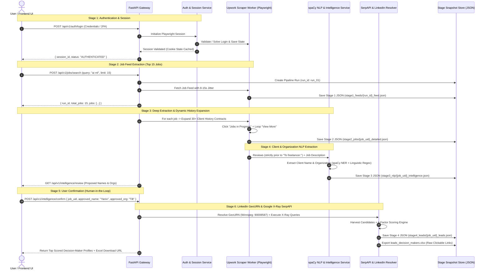
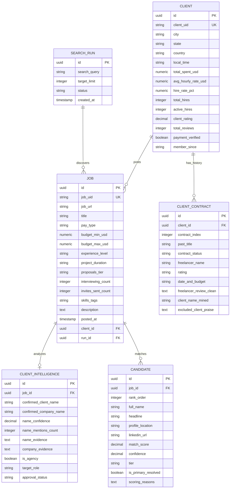

# System Architecture & API Specification

**Project:** Upwork Client Discovery & Decision-Maker Intelligence Platform  
**Target Architecture:** FastAPI, Clean Architecture, Pydantic V2 Multi-Model, Playwright, spaCy NLP, SerpAPI  
**Last Updated:** October 2026  

---

## 1. Executive Summary & Business Vision

The objective of this platform is to automate lead discovery and decision-maker identification for Upwork job postings:
1. **Authenticated Session Handling:** Ingest user Upwork credentials/cookies securely and maintain a persistent, bot-evasive Playwright browser session.
2. **Search Feed Extraction:** Query Upwork for specific keywords (e.g. `ai ml`, `automation`, `python`) and extract the top 15 candidate jobs.
3. **Deep Job Scraping & Dynamic History Expansion:** Navigate to each job page and interactively expand **30+ Client Recent History contracts** by clicking the "Jobs in progress" accordion and looping through the "View more" AJAX pagination button until exhausted.
4. **Strict Review Partitioning:** Extract the freelancer's review of the client **strictly prior to `"To freelancer:"`**. Any text following `"To freelancer:"` contains client praise directed at the freelancer and is safely excluded to prevent false entity extraction.
5. **Client & Organization Intelligence via spaCy NLP:**
   - Scan reviews prior to "To freelancer:" using spaCy NER (`PERSON`) and linguistic regex patterns to extract the true client's name.
   - Scan the job description and job card using spaCy NER (`ORG`) and company pattern rules to identify the client's company/organization.
6. **Human-in-the-Loop Review:** Present extracted client names and company candidates to the user for validation or override.
7. **LinkedIn Discovery & 4-Factor Scoring:**
   - Resolve client location into LinkedIn native `geoUrn` (city/metro/country).
   - Generate precision in-app LinkedIn search URLs with `geoUrn`.
   - Query Google X-Ray searches via SerpAPI (`site:linkedin.com/in/...`).
   - Parse candidates and score them using a 4-factor scoring algorithm (Name 40%, Location 35%, Role 15%, Company 10%) producing Tier A, B, and C matches.
   - Export results into an Excel workbook (`leads_decision_makers.xlsx`) containing raw, clickable URLs.
8. **Stage-by-Stage JSON Persistence:** Save raw and structured JSON snapshots at every phase of the pipeline for full auditability, caching, and resumption.

---

## 2. End-to-End System Workflow



---

## 3. Production Project & Directory Structure

Clean Architecture layering isolating API delivery, business domain, application services, and infrastructure:

```text
upwork-automation/
├── app/
│   ├── __init__.py
│   ├── main.py                          # FastAPI application factory & lifespan
│   ├── config.py                        # Pydantic Settings (env, rate limits, secrets)
│   │
│   ├── api/                             # Presentation Layer (API Routers)
│   │   ├── __init__.py
│   │   ├── v1/
│   │   │   ├── __init__.py
│   │   │   ├── router.py                # Aggregator for v1 endpoints
│   │   │   ├── auth.py                  # POST /auth/login, GET /auth/status
│   │   │   ├── jobs.py                  # POST /jobs/search, GET /jobs/{id}
│   │   │   ├── intelligence.py          # GET /nlp/extract, POST /nlp/confirm
│   │   │   ├── leads.py                 # POST /leads/discover, GET /leads/export
│   │   │   └── pipelines.py             # POST /pipelines/run-batch (End-to-End)
│   │   └── deps.py                      # FastAPI Dependency Injection (DB, Session, Services)
│   │
│   ├── schemas/                         # Pydantic V2 Multi-Model Contracts
│   │   ├── __init__.py
│   │   ├── auth.py                      # LoginRequest, SessionStatusResponse
│   │   ├── job.py                       # JobSearchQuery, JobSummary, JobDetailResponse
│   │   ├── history.py                   # ContractHistoryItem, ReviewPartitionSchema
│   │   ├── intelligence.py              # NlpExtractionResult, UserConfirmationRequest
│   │   └── candidate.py                 # PersonCandidate, ScoredCandidate, LeadExportResponse
│   │
│   ├── services/                        # Business Logic & Orchestration
│   │   ├── __init__.py
│   │   ├── auth_service.py              # Upwork login automation, cookie management
│   │   ├── scraper_service.py           # Playwright job feed & 30+ history expansion
│   │   ├── nlp_service.py               # spaCy NER + Linguistic regex (Client & Org)
│   │   ├── geo_resolver_service.py      # LinkedIn GeoURN mapper (City, State, Country)
│   │   ├── harvester_service.py         # SerpAPI Google X-Ray search & cache
│   │   ├── scorer_service.py            # 4-factor scoring algorithm (Tier A/B/C)
│   │   ├── excel_export_service.py      # OpenPyXL raw URL table generator
│   │   └── storage_service.py           # Stage-by-stage JSON snapshot persistence
│   │
│   ├── core/                            # Cross-Cutting Infrastructure
│   │   ├── exceptions.py                # Domain-specific HTTP exceptions
│   │   ├── logger.py                    # Structured JSON logging
│   │   ├── rate_limiter.py              # Anti-blocking 8-15s jitter & token bucket
│   │   └── security.py                  # Encryption for stored credentials/tokens
│   │
│   └── models/                          # Database / Persistence Models
│       ├── __init__.py
│       ├── run_record.py                # Pipeline execution runs
│       └── lead_record.py               # Persisted leads & decision-makers
│
├── data/                                # Persistent State Store
│   ├── sessions/                        # Encrypted session storage state (upwork_state.json)
│   ├── snapshots/                       # Stage-by-stage extracted JSON files
│   │   ├── stage1_feeds/                # {run_id}_search_top15.json
│   │   ├── stage2_jobs/                 # {job_uid}_detailed_expanded.json
│   │   ├── stage3_nlp/                  # {job_uid}_intelligence_confirmed.json
│   │   └── stage4_leads/                # {job_uid}_scored_leads.json
│   └── exports/                         # Exported .xlsx workbooks
│
├── playground/                          # Prototype modules and verified fixtures
├── context/                             # Architecture, brief, and anti-blocking remedies
├── secrets/                             # .env and local credentials (git-ignored)
├── tests/                               # Comprehensive Pytest test suite
├── pyproject.toml
└── Dockerfile
```

---

## 4. RESTful API Endpoint Contracts

### 4.1 Authentication & Session Management
* **`POST /api/v1/auth/login`**
  * **Description:** Initiates an automated Playwright login to Upwork using credentials, navigates Cloudflare/2FA prompts, and saves session cookies in `data/sessions/upwork_state.json`.
  * **Request Body:**
    ```json
    {
      "username": "user@domain.com",
      "password": "secret_password",
      "security_answer": "optional_answer",
      "headless": true
    }
    ```
  * **Response (200 OK):**
    ```json
    {
      "session_id": "sess_88291a92",
      "is_authenticated": true,
      "user_agent": "Mozilla/5.0 ... Chrome/130",
      "rate_limit_health": "GREEN",
      "expires_at": "2026-11-28T00:00:00Z"
    }
    ```
* **`GET /api/v1/auth/status`**
  * **Description:** Verifies whether the existing cookie session is valid or if a Cloudflare challenge is active.

---

### 4.2 Job Feed Extraction (Top 15 Jobs)
* **`POST /api/v1/jobs/search`**
  * **Description:** Executes a search on Upwork with user keywords (e.g., `"ai ml"`, `"automation"`), parses the feed, and captures the top 15 available jobs into Stage 1 JSON.
  * **Request Body:**
    ```json
    {
      "query": "automation",
      "limit": 15,
      "contractor_tier": 1,
      "sort": "recency"
    }
    ```
  * **Response (200 OK):**
    ```json
    {
      "run_id": "run_20261028_01",
      "query": "automation",
      "total_extracted": 15,
      "snapshot_path": "data/snapshots/stage1_feeds/run_20261028_01_feed.json",
      "jobs": [
        {
          "job_uid": "2114892483288309550",
          "job_url": "https://www.upwork.com/jobs/~022114892483288309550",
          "title": "Senior Full Stack Developer",
          "posted_time": "12 minutes ago",
          "tier": "Expert",
          "budget": "$150K+",
          "client_country": "Canada",
          "teaser_description": "We are seeking a senior full stack developer..."
        }
      ]
    }
    ```

---

### 4.3 Deep Scraping & Dynamic History Expansion (Top 30+ Reviews)
* **`POST /api/v1/jobs/{job_uid}/expand`**
  * **Description:** Opens the specific job, expands the "Jobs in progress" accordion, repeatedly clicks "View more" until at least 30 (or all) history contracts are loaded, partitions the review text strictly prior to `"To freelancer:"`, and persists Stage 2 JSON.
  * **Response (200 OK):**
    ```json
    {
      "job_uid": "2114892483288309550",
      "job_title": "Senior Full Stack Developer",
      "client": {
        "city": "Winnipeg",
        "country": "Canada",
        "total_spent": "$157K total spent",
        "total_history_count_on_upwork": 50,
        "extracted_history_count": 50,
        "in_progress_count": 8,
        "completed_count": 42
      },
      "snapshot_path": "data/snapshots/stage2_jobs/2114892483288309550_detailed.json"
    }
    ```

---

### 4.4 NLP Client & Organization Extraction
* **`GET /api/v1/intelligence/{job_uid}`**
  * **Description:** Runs the dual spaCy + linguistic extraction pipeline on the job description and the partitioned history reviews.
  * **Response (200 OK):**
    ```json
    {
      "job_uid": "2114892483288309550",
      "suggested_client_name": "Yaniv",
      "suggested_organization": "Tilt",
      "confidence": 0.95,
      "client_name_candidates": [
        {
          "name": "Yaniv",
          "confidence": 0.95,
          "mention_count": 12,
          "source": "freelancer_reviews_before_to_freelancer",
          "supporting_contexts": [
            "It was a great experience working with Yaniv...",
            "Working with Mr. Yaniv has been an excellent experience...",
            "Mr. Yaniv was an excellent client..."
          ]
        }
      ],
      "organization_candidates": [
        {
          "name": "Tilt",
          "confidence": 0.85,
          "source": "job_description_spacy_org",
          "supporting_context": "...building features for the Tilt application..."
        }
      ],
      "status": "AWAITING_USER_CONFIRMATION"
    }
    ```

---

### 4.5 Human-in-the-Loop Confirmation
* **`POST /api/v1/intelligence/confirm`**
  * **Description:** The user confirms, edits, or overrides the proposed client name and company name before initiating external search queries.
  * **Request Body:**
    ```json
    {
      "job_uid": "2114892483288309550",
      "confirmed_client_name": "Yaniv",
      "confirmed_organization": "Tilt",
      "target_role": "CTO / Founder"
    }
    ```
  * **Response (200 OK):**
    ```json
    {
      "job_uid": "2114892483288309550",
      "status": "CONFIRMED",
      "snapshot_path": "data/snapshots/stage3_nlp/2114892483288309550_intelligence_confirmed.json"
    }
    ```

---

### 4.6 LinkedIn Discovery, Scoring & Excel Export
* **`POST /api/v1/leads/{job_uid}/discover`**
  * **Description:** Resolves the client location into a LinkedIn `geoUrn`, generates direct in-app LinkedIn search links, runs Google X-Ray queries via SerpAPI, executes 4-factor scoring, saves Stage 4 JSON, and creates an Excel workbook.
  * **Response (200 OK):**
    ```json
    {
      "job_uid": "2114892483288309550",
      "client_name": "Yaniv",
      "location": "Winnipeg, Canada",
      "linkedin_geo_urn": "90008587",
      "direct_search_urls": [
        "https://www.linkedin.com/search/results/people/?keywords=Yaniv&geoUrn=%5B%2290008587%22%5D",
        "https://www.linkedin.com/search/results/people/?keywords=Yaniv&geoUrn=%5B%22101174742%22%5D",
        "https://www.linkedin.com/search/results/people/?keywords=Yaniv&origin=FACETED_SEARCH"
      ],
      "best_candidate": {
        "name": "Yaniv B.",
        "headline": "CTO at Tilt",
        "linkedin_url": "https://www.linkedin.com/in/yanivbirenboim",
        "match_score": 82.0,
        "confidence": 94.5,
        "tier": "Tier A (High Confidence Target)",
        "reasons": [
          "Exact first name match: Yaniv",
          "Metro/City location verified: Winnipeg, Manitoba, Canada",
          "Company confirmed: Tilt"
        ]
      },
      "excel_download_url": "/api/v1/leads/2114892483288309550/export",
      "snapshot_path": "data/snapshots/stage4_leads/2114892483288309550_leads.json"
    }
    ```
* **`GET /api/v1/leads/{job_uid}/export`**
  * **Description:** Streams the generated `.xlsx` workbook with raw, clickable links and auto-fitted columns.

---

## 5. Strict Review Partitioning Specification

To guarantee zero false positives, every contract history item extracted from Upwork must strictly adhere to the following boundary logic:

```python
# Boundary rule: Freelancer's review of the client is strictly BEFORE "To freelancer:"
card_text = job_card.text(strip=True)

if "To freelancer:" in card_text:
    parts = card_text.split("To freelancer:", 1)
    freelancer_review_raw = parts[0]
    excluded_client_praise = "To freelancer: " + parts[1].strip()
else:
    freelancer_review_raw = card_text
    excluded_client_praise = None

# Strip out past job title, rating strings, and UI toggle artifacts ("more", "less")
clean_review = re.sub(r"Rating is [0-9.]+ out of [0-9.]+\s*[0-9.]*\s*(stars)?", "", freelancer_review_raw).strip()
clean_review = re.sub(r"\b(more|less)\b$", "", clean_review).strip()
```

* **Data strictly prior to `"To freelancer:"`** is preserved as `freelancer_review_of_client`.
* **Data following `"To freelancer:"`** is saved into `excluded_section_after_to_freelancer` for audit purposes but **never** submitted to the spaCy entity recognizer.

---

## 6. Master Sales-Ready Excel Schema Specification (`leads_decision_makers.xlsx`)

The final Excel workbook exports the top candidate jobs and enriched decision-makers into a 42-column layout organized into 6 functional zones. All URL columns contain **raw, clickable links** compatible with Excel, Google Sheets, HubSpot, and Apollo:

### Zone 1: Opportunity & Deal Economics (Columns A–I)
1. `job_title` (Text) — Upwork job title.
2. `job_url` (Raw Hyperlink) — Direct link to the Upwork posting.
3. `posted_at_relative` (Text) — e.g. "2 hours ago".
4. `posted_at_iso` (ISO DateTime) — e.g. "2026-10-28T14:15:00Z".
5. `pay_type` (Text) — "Hourly" or "Fixed-price".
6. `budget_min_usd` (Numeric) — Minimum hourly rate (or null for fixed).
7. `budget_max_usd` (Numeric) — Maximum hourly rate or fixed contract budget.
8. `project_duration` (Text) — e.g. "3 to 6 months".
9. `experience_level` (Text) — "Expert", "Intermediate", or "Entry level".

### Zone 2: Competition & Outreach Urgency (Columns J–N)
10. `proposals_tier` (Text) — e.g. "Less than 5", "5 to 10", "10 to 15".
11. `interviewing_count` (Integer) — Candidates currently interviewing.
12. `invites_sent_count` (Integer) — Total invitations sent by client.
13. `unanswered_invites` (Integer) — Unanswered invitations pending.
14. `last_client_activity` (Text) — Relative time of last client view/action.

### Zone 3: Client Credibility & Financial Power (Columns O–Y)
15. `payment_verified` (Boolean) — TRUE / FALSE.
16. `client_rating` (Decimal) — Rating out of 5.0.
17. `client_reviews_count` (Integer) — Total reviews on profile.
18. `client_total_spent_usd` (Numeric) — Lifetime spend on Upwork (e.g. 157000).
19. `client_hire_rate_pct` (Percentage) — Lifetime hire percentage (e.g. 78%).
20. `client_total_hires` (Integer) — Total hires completed.
21. `client_active_hires` (Integer) — Active contracts in progress.
22. `client_avg_hourly_rate` (Numeric) — Average hourly rate paid historically.
23. `client_city` (Text) — Client metro/city (e.g. "Winnipeg").
24. `client_country` (Text) — Client country (e.g. "Canada").
25. `client_local_time` (Text) — Local time for outreach scheduling (e.g. "04:45 AM CDT").
26. `client_member_since` (Text) — Account creation date (e.g. "Apr 2017").

### Zone 4: Extracted Client & Company Intelligence (Columns Z–AH)
27. `client_first_name` (Text) — Extracted decision-maker first name (e.g. "Yaniv").
28. `client_name_confidence` (Percentage) — Algorithmic confidence (e.g. 95%).
29. `client_name_mentions` (Integer) — Distinct review count confirming name (e.g. 12).
30. `client_name_evidence` (Text) — Review snippet proving name.
31. `company_name` (Text) — Organization/Brand name (e.g. "Tilt").
32. `company_evidence` (Text) — Job description snippet proving company.
33. `is_agency` (Boolean) — TRUE if posting is from an agency broker.
34. `agency_detection_reason` (Text) — Linguistic rationale for agency classification.
35. `project_brand_keywords` (Text) — Internal codenames/tools (e.g. "Gemini, EdueBots").

### Zone 5: Direct LinkedIn Decision-Maker Outreach (Columns AI–AP)
36. `decision_maker_name` (Text) — Matched profile full name (e.g. "Yaniv B.").
37. `decision_maker_title` (Text) — Headline / Role (e.g. "CTO at Tilt").
38. `decision_maker_location` (Text) — Profile location (e.g. "Winnipeg, Manitoba, Canada").
39. `match_score_pct` (Percentage) — 4-Factor composite score (e.g. 82.0%).
40. `match_tier` (Text) — "Tier A (High Confidence Target)", "Tier B", "Tier C".
41. `linkedin_profile_url` (Raw Hyperlink) — **Direct 1-click LinkedIn profile URL**.
42. `linkedin_search_url_metro` (Raw Hyperlink) — In-app search with city GeoURN fallback.
43. `linkedin_search_url_country` (Raw Hyperlink) — In-app search with country GeoURN fallback.

### Zone 6: Sales Pitch Hooks & Technical Scope (Columns AQ–AS)
44. `skills_required` (Text) — Comma-separated list of required tech tags.
45. `job_description` (Text) — Complete unclipped job description text.
46. `recommended_pitch_hook` (Text) — AI-tailored opening hook referencing client name, company, and project requirements.

---

## 7. Relational Database Architecture & ER Design (Single Source of Truth)

To provide on-demand filtering, deduplication, historical tracking, and dynamic Excel generation, all extracted and enriched data is persisted into a relational database (**SQLite** for zero-dependency local execution, **PostgreSQL** in production via SQLAlchemy 2.0).

### 7.1 Entity-Relationship (ER) Diagram



### 7.2 Core DDL Specifications

```sql
-- 1. Search Batches
CREATE TABLE search_runs (
    id UUID PRIMARY KEY DEFAULT gen_random_uuid(),
    search_query VARCHAR(100) NOT NULL,
    target_limit INT DEFAULT 15,
    total_jobs_found INT DEFAULT 0,
    status VARCHAR(30) DEFAULT 'COMPLETED',
    created_at TIMESTAMP WITH TIME ZONE DEFAULT NOW()
);
CREATE INDEX idx_search_runs_created ON search_runs(created_at DESC);

-- 2. Client Master
CREATE TABLE clients (
    id UUID PRIMARY KEY DEFAULT gen_random_uuid(),
    client_uid VARCHAR(64) UNIQUE,
    city VARCHAR(100),
    state VARCHAR(100),
    country VARCHAR(100),
    local_time VARCHAR(50),
    total_spent_usd NUMERIC(12, 2) DEFAULT 0.00,
    avg_hourly_rate_usd NUMERIC(8, 2),
    hire_rate_pct NUMERIC(5, 2),
    total_hires INT DEFAULT 0,
    active_hires INT DEFAULT 0,
    client_rating NUMERIC(3, 2),
    total_reviews INT DEFAULT 0,
    payment_verified BOOLEAN DEFAULT TRUE,
    company_size VARCHAR(50),
    industry VARCHAR(100),
    member_since VARCHAR(50),
    created_at TIMESTAMP WITH TIME ZONE DEFAULT NOW(),
    updated_at TIMESTAMP WITH TIME ZONE DEFAULT NOW()
);
CREATE INDEX idx_clients_location ON clients(country, city);
CREATE INDEX idx_clients_spend ON clients(total_spent_usd DESC);

-- 3. Jobs
CREATE TABLE jobs (
    id UUID PRIMARY KEY DEFAULT gen_random_uuid(),
    client_id UUID REFERENCES clients(id) ON DELETE CASCADE,
    run_id UUID REFERENCES search_runs(id) ON DELETE SET NULL,
    job_uid VARCHAR(50) UNIQUE NOT NULL,
    job_url TEXT NOT NULL,
    title VARCHAR(255) NOT NULL,
    pay_type VARCHAR(20) NOT NULL,
    budget_min_usd NUMERIC(10, 2),
    budget_max_usd NUMERIC(10, 2),
    experience_level VARCHAR(50),
    project_duration VARCHAR(100),
    hours_per_week VARCHAR(50),
    proposals_tier VARCHAR(50),
    interviewing_count INT DEFAULT 0,
    invites_sent_count INT DEFAULT 0,
    unanswered_invites INT DEFAULT 0,
    skills_tags TEXT,
    description TEXT NOT NULL,
    posted_at TIMESTAMP WITH TIME ZONE,
    created_at TIMESTAMP WITH TIME ZONE DEFAULT NOW()
);
CREATE INDEX idx_jobs_uid ON jobs(job_uid);
CREATE INDEX idx_jobs_pay ON jobs(pay_type, budget_max_usd DESC);

-- 4. 30-50 Client History Contracts (Strictly Partitioned)
CREATE TABLE client_contracts (
    id UUID PRIMARY KEY DEFAULT gen_random_uuid(),
    client_id UUID NOT NULL REFERENCES clients(id) ON DELETE CASCADE,
    contract_index INT NOT NULL,
    past_title VARCHAR(255),
    contract_status VARCHAR(30) NOT NULL,
    freelancer_name VARCHAR(100),
    rating VARCHAR(20),
    date_and_budget VARCHAR(150),
    freelancer_review_clean TEXT,            -- STRICTLY PRIOR to "To freelancer:"
    client_name_mined VARCHAR(100),
    excluded_client_praise TEXT,             -- Isolated text after "To freelancer:"
    created_at TIMESTAMP WITH TIME ZONE DEFAULT NOW()
);
CREATE INDEX idx_contracts_client ON client_contracts(client_id);
CREATE INDEX idx_contracts_mined_name ON client_contracts(client_name_mined);

-- 5. NLP Intelligence & Confirmations
CREATE TABLE client_intelligence (
    id UUID PRIMARY KEY DEFAULT gen_random_uuid(),
    job_id UUID UNIQUE NOT NULL REFERENCES jobs(id) ON DELETE CASCADE,
    confirmed_client_name VARCHAR(100) NOT NULL,
    confirmed_company_name VARCHAR(150),
    target_role VARCHAR(100) DEFAULT 'CTO',
    name_confidence NUMERIC(5, 2) DEFAULT 0.00,
    name_mentions_count INT DEFAULT 1,
    name_evidence_snippet TEXT,
    company_evidence_snippet TEXT,
    is_agency BOOLEAN DEFAULT FALSE,
    agency_detection_reason TEXT,
    approval_status VARCHAR(30) DEFAULT 'APPROVED',
    confirmed_at TIMESTAMP WITH TIME ZONE DEFAULT NOW()
);
CREATE INDEX idx_intel_job ON client_intelligence(job_id);

-- 6. Candidates (Resolved Top Match + All Potential Candidates)
CREATE TABLE candidates (
    id UUID PRIMARY KEY DEFAULT gen_random_uuid(),
    job_id UUID NOT NULL REFERENCES jobs(id) ON DELETE CASCADE,
    rank_order INT NOT NULL,
    full_name VARCHAR(150) NOT NULL,
    headline TEXT,
    profile_location TEXT,
    linkedin_url TEXT NOT NULL,
    match_score NUMERIC(5, 2) NOT NULL,
    confidence NUMERIC(5, 2) NOT NULL,
    tier VARCHAR(50) NOT NULL,
    is_primary_resolved BOOLEAN DEFAULT FALSE,
    scoring_reasons JSONB,
    created_at TIMESTAMP WITH TIME ZONE DEFAULT NOW()
);
CREATE INDEX idx_candidates_job ON candidates(job_id);
CREATE INDEX idx_candidates_tier ON candidates(tier);
CREATE INDEX idx_candidates_primary ON candidates(is_primary_resolved);
```

---

## 8. Dual Candidate Delivery: Primary Resolved vs Potential Candidates

The discovery engine does not discard secondary search results from SerpAPI Google X-Ray. It scores and surfaces **two distinct tiers of output**:

1. **Primary Resolved Candidate (Tier A Decision-Maker):**
   * Highest scoring match exceeding the Tier A threshold (Score $\ge 80\%$, Confidence $\ge 90\%$).
   * Exact name, matching metro/city, and leadership role (e.g. **Yaniv B.** — CTO at Tilt).
   * Populates the primary outreach columns in the master Excel view.
2. **Potential Candidates (Tier B & Tier C Runners-Up):**
   * Discovered candidates that matched the name or location partially (e.g. **Yaniv Butorov** — University of Manitoba Honors Student, Winnipeg).
   * Stored in `candidates` table with `is_primary_resolved = FALSE`.
   * Exported in the Excel workbook as secondary rows or alternative contact columns so the sales team has backup leads if the primary target is unresponsive.

---

## 9. Stage-by-Stage JSON Snapshot Persistence Layout

All workflow progress continues to be written to disk under `data/snapshots/` as an immutable audit trail and rapid local cache:

| Stage | Path Pattern | Contents |
| :--- | :--- | :--- |
| **Stage 1** | `data/snapshots/stage1_feeds/{run_id}_feed.json` | Top 15 jobs returned by Upwork search feed. |
| **Stage 2** | `data/snapshots/stage2_jobs/{job_uid}_detailed.json` | Job specs + 30–50 expanded history contracts with partitioned reviews. |
| **Stage 3** | `data/snapshots/stage3_nlp/{job_uid}_intelligence.json` | spaCy entity outputs, linguistic review matches, and user approval record. |
| **Stage 4** | `data/snapshots/stage4_leads/{job_uid}_leads.json` | GeoURN, generated search URLs, SerpAPI Google X-Ray responses, candidate scores. |

---

## 10. Anti-Blocking & Rate-Limiting Controls

1. **Jitter Delay (8–15s):** When iterating through the top 15 jobs, a random sleep between 8 and 15 seconds is introduced between individual job navigations.
2. **Snapshot-First Caching:** If a job UID already has a valid snapshot in `data/snapshots/stage2_jobs/{job_uid}_detailed.json` or in the database, the pipeline skips live navigation unless `--force-live` is specified.
3. **SerpAPI Workload Offloading:** All LinkedIn candidate harvesting queries run through SerpAPI's Google X-Ray endpoints, eliminating any scraping footprint against LinkedIn and insulating the Upwork IP address.
4. **Human-in-the-Loop Safeguard:** Stage 5 gives the operator manual validation control before any SerpAPI search credits are consumed.

