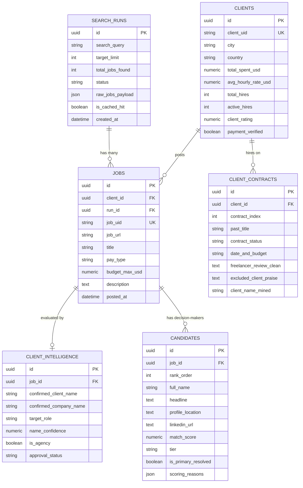

# Architecture and End-to-End Data Flow Specification

## 1. System Overview

The Upwork Lead Discovery and Decision-Maker Scoring Platform is a multi-stage autonomous pipeline designed to unmask anonymous Upwork clients, discover their corporate identities, identify executive decision-makers on LinkedIn, score candidates using a 4-factor relevance algorithm, and generate sales-ready outreach workbooks.

The architecture is partitioned into:
1. **Frontend Cockpit**: Modern React 18, TypeScript, Tailwind CSS, TanStack Query, Lucide icons, Framer Motion.
2. **FastAPI Gateway**: Asynchronous REST API serving endpoints for authentication, scraping, NLP intelligence, candidate scoring, and dashboard analytics.
3. **Engine Services Layer**: Specialized decoupled Python domain services coordinating Playwright scraping, spaCy NLP, GeoURN resolution, SerpAPI harvesting, algorithmic scoring, and OpenPyXL workbook authoring.
4. **Relational Database**: PostgreSQL (via SQLAlchemy 2.0 AsyncPG ORM) acting as the source of truth with foreign key cascading and strict temporal cache constraints.
5. **JSON Snapshot Storage**: Tiered file snapshots (`data/snapshots/stage1_feed/`, `data/snapshots/stage2_jobs/`, etc.) ensuring reproducible audit trails and testing mocks.

---

## 2. High-Level Data Flow Diagram

```mermaid
flowchart TD
    User["User / UI Cockpit"] -->|"1. Search query ('automation')"| API_Search["POST /api/v1/jobs/search"]
    
    subgraph Stage1["Stage 1: Job Feed Ingestion & 1-Hour Cache"]
        API_Search -->|"Check cache (< 1 hour)"| DB_SearchRuns["search_runs table"]
        DB_SearchRuns -->|"Cache Hit (<3600s)"| ReturnFeed["Return Cached Jobs"]
        DB_SearchRuns -->|"Cache Miss / Force Live"| Playwright_Feed["scraper_service.fetch_search_feed()"]
        Playwright_Feed -->|"Parse HTML"| Parse_Feed["scraper_service.parse_search_feed()"]
        Parse_Feed -->|"Store Run & Raw JSON"| DB_SearchRuns
    end

    User -->|"2. Click Job / Fetch History"| API_Expand["POST /api/v1/jobs/{job_uid}/expand"]

    subgraph Stage2["Stage 2: Deep Contract Scraping & Partitioning"]
        API_Expand --> Playwright_Detail["scraper_service.fetch_job_details()"]
        Playwright_Detail --> Parse_Detail["scraper_service.parse_job_details()"]
        Parse_Detail -->|"Partition reviews strictly prior to 'To freelancer:'"| CleanReviews["Clean Freelancer Praise"]
        Parse_Detail -->|"Isolate client praise"| ExcludedPraise["Excluded Client Praise"]
        Parse_Detail --> Sync_DB["scraper_service.sync_job_details_to_db()"]
        Sync_DB --> DB_Clients["clients table"]
        Sync_DB --> DB_Jobs["jobs table"]
        Sync_DB --> DB_Contracts["client_contracts table (Up to 50)"]
    end

    User -->|"3. Analyze Intelligence"| API_Intel["GET /api/v1/intelligence/{job_uid}"]

    subgraph Stage3["Stage 3: NLP Entity Mining & HITL Approval"]
        API_Intel --> NLP_Service["nlp_service.analyze_job_intelligence()"]
        NLP_Service -->|"spaCy PERSON entities + Regex Greetings"| ClientNameExtractor["nlp_service.extract_client_names()"]
        NLP_Service -->|"spaCy ORG entities + Domain Regex"| OrgExtractor["nlp_service.extract_organization_names()"]
        NLP_Service -->|"Freelance Agency Heuristics"| AgencyDetector["nlp_service.detect_agency()"]
        ClientNameExtractor --> HITL_Dialog["HITL Confirmation Dialog"]
        User -->|"Confirm Name & Role"| API_Confirm["POST /api/v1/intelligence/confirm"]
        API_Confirm --> DB_Intel["client_intelligence table"]
    end

    User -->|"4. Discover Decision-Makers"| API_Discover["POST /api/v1/leads/{job_uid}/discover"]

    subgraph Stage4["Stage 4: GeoURN Resolution & Candidate Harvesting"]
        API_Discover --> Geo_Service["geo_resolver.generate_search_variants()"]
        Geo_Service -->|"Resolve City/State/Country to LinkedIn URN"| SearchUrls["Generate 5 Direct LinkedIn & X-Ray URLs"]
        SearchUrls --> Harvester["harvester_service.execute_google_xray_searches()"]
        Harvester -->|"SerpAPI live query or cache"| GoogleResults["Google Organic LinkedIn Profiles"]
    end

    subgraph Stage5["Stage 5: 4-Factor Candidate Scoring & Dual Delivery"]
        GoogleResults --> Scorer["scorer_service.score_candidates()"]
        Scorer -->|"Name 40%, Location 35%, Role 15%, Company 10%"| ScoredProfiles["Calculate Match Score"]
        ScoredProfiles --> Splitter["scorer_service.dual_delivery_split()"]
        Splitter -->|"Primary Match (Tier A >= 70%)"| ResolvedCandidate["Resolved Decision-Maker"]
        Splitter -->|"Potential Matches (Tier B & C)"| PotentialCandidates["Ranked Potential Matches"]
        Splitter --> Sync_Candidates["Commit Candidates to PostgreSQL"]
        Sync_Candidates --> DB_Candidates["candidates table"]
    end

    User -->|"5. Export Leads"| API_Export["GET /api/v1/leads/{job_uid}/export"]

    subgraph Stage6["Stage 6: Sales Spreadsheet Authoring"]
        API_Export --> Excel_Service["excel_export_service.export_from_db()"]
        Excel_Service --> Sales_Pitch["excel_export_service._generate_sales_pitch()"]
        Sales_Pitch --> OpenPyXL["Generate 46-Column .xlsx with Hyperlinks"]
        OpenPyXL --> Download[".xlsx Workbook Download"]
    end
```



---

## 3. Detailed Data Flow by Stage and Function Call

### Stage 1: Search Feed Harvesting and 1-Hour Database Cache

1. **Trigger**: User types a search query (e.g., `automation`) into the UI search bar and clicks **Search Jobs**, dispatching `POST /api/v1/jobs/search`.
2. **Controller**: [`app/api/v1/jobs.py:search_jobs()`](file:///home/sudhanshu/Documents/upwork-automation/app/api/v1/jobs.py#L22)
   - Checks `force_live` flag. If `False`, queries PostgreSQL for an existing `SearchRun`:
     ```sql
     SELECT * FROM search_runs 
     WHERE lower(search_query) = lower(:query) AND status = 'COMPLETED'
     ORDER BY created_at DESC LIMIT 1;
     ```
   - Checks if `(now_utc - run.created_at) < 3600 seconds` (1 hour).
   - **Cache HIT**: Instantly deserializes `run.raw_jobs_payload` from PostgreSQL without hitting Upwork.
   - **Cache MISS**: Invokes the Playwright scraper pipeline.
3. **Scraper Execution**:
   - [`scraper_service.fetch_search_feed(query, limit)`](file:///home/sudhanshu/Documents/upwork-automation/app/services/scraper_service.py#L117):
     - Injects saved session co<!--  -->okies from `data/sessions/upwork_session.json` into Playwright's browser context.
     - Navigates to `https://www.upwork.com/nx/search/jobs/?q={encoded_query}&sort=recency`.
     - Applies human-like jitter (`random.uniform(8.0, 15.0)` seconds).
     - Dumps raw HTML snapshot to `data/snapshots/stage1_feed/{run_id}.html`.
   - [`scraper_service.parse_search_feed(html_content)`](file:///home/sudhanshu/Documents/upwork-automation/app/services/scraper_service.py#L182):
     - Extracts job UID (`~02...`), job title, budget, experience level, client location snippet, and client total spend.
   - [`scraper_service.sync_search_feed_to_db(query, limit, jobs, session)`](file:///home/sudhanshu/Documents/upwork-automation/app/services/scraper_service.py#L236):
     - Inserts a new record into `search_runs` with `raw_jobs_payload` and `is_cached_hit = False`.
4. **Data Propagation**:
   - The returned job objects (`FeedJobItem`) populate the left table in the React dashboard.
   - The search keyword is registered in the **Search Query Domains** pill bar with a live countdown timer.

---

### Stage 2: Deep Job Details and 50-Contract Review Partitioning

1. **Trigger**: User clicks **Fetch Client History** (or selects a job card), triggering `POST /api/v1/jobs/{job_uid}/expand`.
2. **Controller**: [`app/api/v1/jobs.py:expand_job_details()`](file:///home/sudhanshu/Documents/upwork-automation/app/api/v1/jobs.py#L38)
3. **Scraper Execution**:
   - [`scraper_service.fetch_job_details(job_uid)`](file:///home/sudhanshu/Documents/upwork-automation/app/services/scraper_service.py#L280):
     - Loads `https://www.upwork.com/jobs/~02{job_uid}`.
     - Waits for DOM selector `[data-test="JobDetails"]` and reviews pagination.
   - [`scraper_service.parse_job_details(html_content)`](file:///home/sudhanshu/Documents/upwork-automation/app/services/scraper_service.py#L358):
     - Extracts comprehensive client metrics: total spent USD, average hourly rate, hire rate percentage, total hires, active hires, client rating, city, country, company size, industry, and member since date.
     - Extracts up to 50 past client contracts.
     - **Strict Review Partitioning**:
       - Locates `"To freelancer:"` delimiter in each review block.
       - Text *before* `"To freelancer:"` is saved as `freelancer_review_clean` (the freelancer's feedback regarding the client).
       - Text *after* `"To freelancer:"` is saved as `excluded_client_praise` (the client's review of the freelancer, isolated so client praise does not corrupt the name extractor).
4. **Database Persistence**:
   - [`scraper_service.sync_job_details_to_db(parsed_data, session)`](file:///home/sudhanshu/Documents/upwork-automation/app/services/scraper_service.py#L480):
     - Inserts or updates `clients` table (keyed by `client_uid` or generated UUID).
     - Inserts or updates `jobs` table (linked to `client_id` and `run_id`).
     - Inserts up to 50 rows in `client_contracts` (linked to `client_id`).

---

### Stage 3: NLP Entity Mining and Human-in-the-Loop Confirmation

1. **Trigger**: User opens the **Client Profile** tab, triggering `GET /api/v1/intelligence/{job_uid}`.
2. **Controller**: [`app/api/v1/intelligence.py:extract_job_intelligence()`](file:///home/sudhanshu/Documents/upwork-automation/app/api/v1/intelligence.py#L20)
3. **NLP Service Execution**:
   - [`nlp_service.analyze_job_intelligence(job_id, job_uid, description, contracts, session)`](file:///home/sudhanshu/Documents/upwork-automation/app/services/nlp_service.py#L52):
     - [`nlp_service.extract_client_names(contracts)`](file:///home/sudhanshu/Documents/upwork-automation/app/services/nlp_service.py#L95):
       - Iterates through `freelancer_review_clean` across all contracts.
       - Runs regex patterns for common greetings:
         - `(?:thanks?|thank you|working with|great working with)\s+([A-Z][a-z]+)`
         - `([A-Z][a-z]+)\s+was (?:great|a pleasure|helpful|very clear)`
       - Runs spaCy NER model (`en_core_web_sm`) to detect `PERSON` entities.
       - Filters out false positives (e.g., "Upwork", "Freelancer", day names, tools).
       - Computes confidence based on mention count, recency, and syntax structure.
     - [`nlp_service.extract_organization_names(description, contracts)`](file:///home/sudhanshu/Documents/upwork-automation/app/services/nlp_service.py#L182):
       - Identifies `ORG` entities from job description and contract titles.
       - Extracts email domains and company indicators ("Inc", "LLC", "Studio", "Labs").
     - [`nlp_service.detect_agency(description, contracts, client)`](file:///home/sudhanshu/Documents/upwork-automation/app/services/nlp_service.py#L240):
       - Evaluates agency indicators (e.g. "for our client", multiple disparate industries, massive contract volume with low ticket size).
4. **Human-in-the-Loop Confirmation**:
   - User reviews the suggested client and company names in the **Verify Client Details** dialog.
   - User clicks **Confirm & Discover Decision-Makers**, posting to `POST /api/v1/intelligence/confirm`:
     - [`nlp_service.confirm_intelligence(confirmation_request, session)`](file:///home/sudhanshu/Documents/upwork-automation/app/services/nlp_service.py#L310):
     - Inserts or updates `client_intelligence` table with `approval_status = 'APPROVED'`.

---

### Stage 4: GeoURN Resolution and Candidate Harvesting

1. **Trigger**: User clicks **Find Decision-Makers on LinkedIn**, calling `POST /api/v1/leads/{job_uid}/discover`.
2. **Controller**: [`app/api/v1/leads.py:discover_decision_makers()`](file:///home/sudhanshu/Documents/upwork-automation/app/api/v1/leads.py#L26)
3. **Location & URL Resolution**:
   - [`geo_resolver.generate_search_variants(client_name, city, country)`](file:///home/sudhanshu/Documents/upwork-automation/app/services/geo_resolver_service.py#L75):
     - Resolves country/city to LinkedIn `geoUrn` facet codes:
       - United States: `103644278`
       - United Kingdom: `102257491`
       - Canada: `90008587`
       - Australia: `101452733`
     - Generates 5 targeted in-app search links:
       1. **Target Metro Search**: `https://www.linkedin.com/search/results/people/?keywords={name}&geoUrn=[{geo_urn}]`
       2. **Direct Name Search**: `https://www.linkedin.com/search/results/people/?keywords={name}`
       3. **Name + City Search**: `https://www.linkedin.com/search/results/people/?keywords={name}%20{city}`
       4. **Name + Country Search**: `https://www.linkedin.com/search/results/people/?keywords={name}%20{country}`
       5. **Google X-Ray Search**: `https://www.google.com/search?q=site:linkedin.com/in/+%22{name}%22+%22{city}%22`
4. **SerpAPI Profile Harvesting**:
   - [`harvester_service.execute_google_xray_searches(variants)`](file:///home/sudhanshu/Documents/upwork-automation/app/services/harvester_service.py#L42):
     - Runs Google X-Ray search query: `site:linkedin.com/in/ "{client_name}" "{location}"`.
     - Caches JSON response to `data/cache/serpapi/{query_hash}.json`.
     - Parses organic search results: extracts canonical profile URL, headline, location, and full name.

---

### Stage 5: 4-Factor Candidate Scoring and Dual Delivery

1. **Algorithmic Scoring**:
   - [`scorer_service.score_candidates(raw_candidates, target)`](file:///home/sudhanshu/Documents/upwork-automation/app/services/scorer_service.py#L45):
   - Computes weighted score across 4 distinct dimensions:
     $$\text{Total Score} = 0.40 \times \text{Name} + 0.35 \times \text{Location} + 0.15 \times \text{Role} + 0.10 \times \text{Company}$$
     - **Name Score (40%)**: Token sort ratio and Levenshtein distance between mined client name and candidate profile name.
     - **Location Score (35%)**: Fuzzy token matching against verified client city, state, and country.
     - **Role Score (15%)**: Executive keyword density (Founder, Co-Founder, CEO, CTO, VP, Director, Owner).
     - **Company Score (10%)**: Token overlap with verified company name.
2. **Tier Classification**:
   - **Tier A (Strong Match)**: Score $\ge 70.0$.
   - **Tier B (Potential Match)**: Score $50.0 - 69.9$.
   - **Tier C (Low Match)**: Score $< 50.0$.
3. **Dual Delivery Partition**:
   - **Primary Resolved Candidate**: Highest ranked candidate meeting Tier A threshold.
   - **Potential Candidates**: All remaining ranked candidates (Tier B & C) presented for human validation.
4. **PostgreSQL Sync**:
   - Writes records to `candidates` table (linked to `job_id`).
   - Writes Stage 4 JSON snapshot to `data/snapshots/stage4_scored/{job_uid}.json`.

---

### Stage 6: Sales Spreadsheet Authoring

1. **Trigger**: User clicks **Export Leads (.xlsx)**, invoking `GET /api/v1/leads/{job_uid}/export` or `GET /api/v1/leads/export`.
2. **Controller**: [`app/api/v1/leads.py:export_job_leads_excel()`](file:///home/sudhanshu/Documents/upwork-automation/app/api/v1/leads.py#L194)
3. **Workbook Construction**:
   - [`excel_export_service.export_from_db(session, job_uid)`](file:///home/sudhanshu/Documents/upwork-automation/app/services/excel_export_service.py#L120):
     - Fetches jobs, client financials, intelligence, and candidates.
     - Constructs a 46-column openpyxl workbook:
       - Header styling: Dark slate background (`#2C3E50`), white bold text, auto-fit column widths.
       - Hyperlinks: Direct clickable links for Upwork Job URL and LinkedIn Profile URL.
       - Financials: Client total spend, average hourly rate, hire rate percentage.
       - Decision-maker metrics: Match score, match tier, profile location, headline.
     - [`excel_export_service._generate_sales_pitch(job, client, candidate)`](file:///home/sudhanshu/Documents/upwork-automation/app/services/excel_export_service.py#L225):
       - Generates tailored cold outreach message hooks referencing the specific job requirements, client's past hiring history, and the decision-maker's LinkedIn role.
4. **Delivery**:
   - Streams file as `application/vnd.openxmlformats-officedocument.spreadsheetml.sheet`.

---

## 4. Function Connectivity and Call Matrix

| Calling Function | Target Service Function | Arguments Passed | Data Returned | Primary Side-Effect |
| :--- | :--- | :--- | :--- | :--- |
| `jobs.search_jobs()` | `scraper_service.fetch_search_feed()` | `query: str, limit: int` | `HTML string` | Writes `stage1_feed/{run_id}.html` |
| `jobs.search_jobs()` | `scraper_service.parse_search_feed()` | `html_content: str` | `List[FeedJobItem]` | In-memory parsing |
| `jobs.search_jobs()` | `scraper_service.sync_search_feed_to_db()`| `query, limit, jobs, db` | `SearchRun instance` | Inserts into `search_runs` table |
| `jobs.expand_job_details()`| `scraper_service.fetch_job_details()` | `job_uid: str` | `HTML string` | Writes `stage2_jobs/{uid}.html` |
| `jobs.expand_job_details()`| `scraper_service.parse_job_details()` | `html_content: str` | `Dict[str, Any]` | Partitions 50 contracts |
| `jobs.expand_job_details()`| `scraper_service.sync_job_details_to_db()`| `parsed_data, db` | `Job instance` | Inserts `clients`, `jobs`, `client_contracts` |
| `intelligence.extract()` | `nlp_service.analyze_job_intelligence()` | `job_id, uid, desc, contracts`| `IntelligenceExtractionResponse`| Writes `stage3_intelligence/{uid}.json` |
| `intelligence.confirm()` | `nlp_service.confirm_intelligence()` | `UserConfirmationRequest, db` | `ClientIntelligence instance` | Upserts `client_intelligence` |
| `leads.discover()` | `geo_resolver.generate_search_variants()`| `name, city, country` | `List[Dict[str, Any]]` | Resolves LinkedIn GeoURN codes |
| `leads.discover()` | `harvester_service.execute_google_xray_searches()`| `variants: List[Dict]` | `List[PersonCandidate]` | Reads/writes SerpAPI cache |
| `leads.discover()` | `scorer_service.score_candidates()` | `candidates, LeadTarget` | `List[ScoredCandidate]` | Computes 4-factor weights |
| `leads.export()` | `excel_export_service.export_from_db()` | `db, job_uid, filters` | `Path (Path to .xlsx)` | Writes file in `data/exports/` |

---

## 5. Relational Database Schema and Invariants



---

## 6. API Endpoints Map

### Authentication Router (`/api/v1/auth`)
- `GET /status`: Returns session health, cookie count, and rate limit traffic light (`GREEN`, `YELLOW`, `RED`).
- `POST /verify`: Performs live authenticated probe against Upwork GraphQL.
- `POST /session/import`: Imports raw browser cookies JSON and validates security tokens.
- `GET /sessions`: Lists stored session identities.

### Jobs and Search Router (`/api/v1/jobs`)
- `POST /search`: Stage 1 keyword search with 1-hour database caching.
- `GET /domains`: Lists all executed search query domains with cache countdowns.
- `GET /domains/{query}/jobs`: Retrieves cached jobs for a domain.
- `GET /dashboard/stats`: Returns cockpit metrics (harvested jobs, domains, potential clients, rate limit health).
- `GET /dashboard/clients`: Retrieves potential clients directory with financial stats, origin jobs, and candidate summaries.
- `GET /all`: Returns all jobs currently in PostgreSQL.
- `POST /{job_uid}/expand`: Stage 2 deep scraping of client metrics and 50 past contracts.
- `GET /{job_uid}`: Full job entity, client profile, and contracts from PostgreSQL.

### Intelligence Router (`/api/v1/intelligence`)
- `GET /{job_uid}`: Stage 3 NLP entity mining (client name, company, agency classification).
- `POST /confirm`: Human-in-the-Loop user approval for extracted client and company identity.

### Leads and Discovery Router (`/api/v1/leads`)
- `POST /{job_uid}/discover`: Stages 4 and 5 LinkedIn GeoURN resolution, SerpAPI harvesting, and 4-factor scoring.
- `GET /{job_uid}/export`: Downloads 46-column Excel workbook for a single job lead.
- `GET /export`: Master multi-lead Excel export with filtering.

### Pipeline Automation Router (`/api/v1/pipelines`)
- `POST /job-run`: Executes the end-to-end single-job pipeline (Stages 1 through 5) autonomously.

---

## 7. Frontend Reactive State Architecture

The user interface coordinates state via **TanStack Query** (React Query):

1. **Query Keys**:
   - `['job-details', jobUid]`: Cached full job data from `GET /api/v1/jobs/{job_uid}`.
   - `['job-leads', jobUid]`: Discovered decision-makers from `POST /api/v1/leads/{job_uid}/discover`.
   - `['dashboard-stats']`: 4-factor metric counters.
   - `['job-domains']`: Search domain list.
   - `['dashboard-clients']`: Potential clients modal directory.
2. **Auto-Navigation & Feedback**:
   - Triggering **Find Decision-Makers** automatically switches the active inspector tab to `Decision-Makers`.
   - An animated loader runs during the SerpAPI and scoring calculation.
   - When finished, query invalidation updates the cockpit counters, clients directory, and candidate badges synchronously without page reloads.

