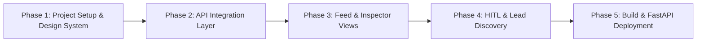

# Frontend Architecture and Implementation Plan
## Lead Intelligence - Upwork Decision-Maker Discovery Platform

**Document Version:** 1.0.0  
**Target Audience:** Engineering, Product, and Design  
**Backend Parity:** FastAPI API v1 (`/api/v1/auth`, `/api/v1/jobs`, `/api/v1/intelligence`, `/api/v1/leads`, `/api/v1/pipelines`)  
**Design Standard:** StyleSeed System Architecture (`/ui-component`, `/ui-pattern`, `/ui-motion`)  
**Zero-Slop Rule:** Anti-AI aesthetic. High-density, tactile, editorial B2B ergonomics. Zero purple gradients, zero blurry glassmorphism, zero floating orbs.

---

## 1. Technology Selection and Rationales

### 1.1 Selected Technology Stack

| Layer | Recommended Choice | Rationale |
|---|---|---|
| **Language** | **TypeScript 5.x** | Guarantees strict static type safety matching FastAPI Pydantic V2 schemas. Eliminates runtime data shape bugs across complex nested contracts and scoring candidates. |
| **Framework** | **React 19 with Vite 6** | Ultra-fast Hot Module Replacement (HMR), zero bloat, instant cold start, and builds directly into static assets served natively by FastAPI's existing `StaticFiles` mount at `/static`. |
| **Styling** | **Tailwind CSS v4** | Utilizes native CSS variables for design tokens. Directly compatible with the StyleSeed token and component specification without CSS runtime overhead. |
| **Component Primitives** | **Radix UI Primitives** | Headless, unstyled accessible primitives (Dialog, Tabs, Popover, Dropdown, Tooltip, Collapsible) adhering to WCAG 2.1 AA keyboard navigation and ARIA guidelines. |
| **Motion Engine** | **Framer Motion 11** | Implementation target for StyleSeed motion seeds (`Snap`, `Silk`, `Spring`) and calibrated moves (`toggle-flip`, `stagger-cascade`, `shimmer`). |
| **Icons** | **Lucide React** | Precise, minimalist stroke icons (1.5px/1.75px stroke width). No gimmick or decorative AI spark/magic wand icons. |
| **Data Fetching & State** | **TanStack Query (React Query) v5** | Built-in caching, background revalidation, optimistic mutations, and polling/refetch states for asynchronous scraping jobs and pipeline runs. |
| **Table Virtualization** | **TanStack Table v8** | High-performance headless data grid for multi-column job feeds, contract listings, and candidate lists. |

### 1.2 Port Architecture & Two-Tier Decoupling

1. **Frontend Dedicated Host on Port 3000**:
   The frontend runs on `http://localhost:3000` via Vite. In both development and production preview, Vite proxies all `/api/*` traffic directly to `http://127.0.0.1:8000`, enabling seamless hot module replacement and decoupled frontend deployments.
2. **Backend API Gateway on Port 8000**:
   The FastAPI backend operates strictly as a REST API gateway on `http://localhost:8000`. The monolithic `static/index.html` has been removed from port 8000, and root `/` returns a pure JSON status record containing API metadata, documentation links, and the frontend dev address.
3. **Isolated Build Distribution**:
   Frontend builds output to `frontend/dist/` instead of polluting the backend `static/` directory.
4. **Schema Synchronization**:
   FastAPI exposes automated OpenAPI specs at `/openapi.json`. Typed API clients in `frontend/src/services/api.ts` mirror backend Pydantic models for full type safety across search, expansion, intelligence mining, candidate scoring, and Excel exports.

---

## 2. Color Palette and Semantic Design Tokens

The user-specified palette has been structured into an executive, high-legibility design token system:

```
Palette Breakdown:
1. #FBFCFC - Canvas Off-White / Pure Porcelain (Background, Crisp Card Surfaces)
2. #0F3D3E - Deep Spruce Slate (Primary Typography, Dark Ink, Structural Frames)
3. #14746F - Pine Emerald Teal (Primary Action Brand, Selected States, High-Value Accents)
4. #8EB69B - Sage Mist (Borders, Soft Badges, Muted Pills, Tonal Fills)
```

### 2.1 Token Hierarchy (Light Mode Default - Executive Precision)

```css
:root {
  /* Base Canvas and Surfaces */
  --color-canvas-bg: #FBFCFC;            /* Clean light background */
  --color-surface-card: #FFFFFF;         /* Crisp white card surface */
  --color-surface-subtle: #F3F7F5;       /* Very soft sage-tinted container */
  --color-surface-sunken: #EAF0EC;       /* Inputs, code blocks, tabular headers */

  /* Structural Borders */
  --color-border-subtle: #E1EBE6;        /* Subtle divider */
  --color-border-default: #8EB69B;       /* Active card borders, inputs */
  --color-border-strong: #0F3D3E;        /* Focus rings and active tabs */

  /* Typography */
  --color-text-primary: #0F3D3E;         /* Deep spruce - High contrast headers and body */
  --color-text-secondary: #2C5756;       /* Mid spruce - Metadata, labels, secondary info */
  --color-text-muted: #5A7E7B;           /* Low contrast - Timestamps, hints, inactive tabs */
  --color-text-inverse: #FBFCFC;         /* Text on dark buttons and banners */

  /* Brand Interactive States */
  --color-brand-primary: #14746F;        /* Buttons, CTA, active toggle */
  --color-brand-hover: #0F3D3E;          /* Hover transition for primary CTA */
  --color-brand-active: #0B2C2D;        /* Pressed state */
  --color-brand-tint: #E6F3F1;           /* Soft brand wash for selected rows */

  /* Decision-Maker Scoring Tiers */
  --color-tier-a-bg: #E3F2ED;            /* Tier A (>= 70% Match): Emerald Sage Wash */
  --color-tier-a-border: #14746F;        /* Tier A Border */
  --color-tier-a-text: #0F3D3E;          /* Tier A Label */

  --color-tier-b-bg: #EDF4EE;            /* Tier B (40-69% Match): Neutral Sage Wash */
  --color-tier-b-border: #8EB69B;        /* Tier B Border */
  --color-tier-b-text: #205047;          /* Tier B Label */

  --color-tier-c-bg: #F5F7F6;            /* Tier C (< 40% Match): Subdued Neutral Wash */
  --color-tier-c-border: #CCD9D3;        /* Tier C Border */
  --color-tier-c-text: #6A827E;          /* Tier C Label */

  /* System Indicators */
  --color-status-success: #14746F;
  --color-status-warning: #B37D2C;
  --color-status-error: #A33B3B;
  --color-status-info: #2B6F8A;

  /* Elevation Shadows (Tailored for zero-slop solid realism) */
  --shadow-card: 0 1px 3px 0 rgba(15, 61, 62, 0.05), 0 1px 2px -1px rgba(15, 61, 62, 0.05);
  --shadow-elevated: 0 4px 6px -1px rgba(15, 61, 62, 0.08), 0 2px 4px -2px rgba(15, 61, 62, 0.06);
  --shadow-modal: 0 20px 25px -5px rgba(15, 61, 62, 0.15), 0 8px 10px -6px rgba(15, 61, 62, 0.1);
}
```

### 2.2 Dark Mode Variant (Command Deck Mode)

For users preferring dark terminal mode, the same palette maps naturally:
- Canvas Background: `#071E1F` (Deep midnight spruce)
- Surface Cards: `#0F3D3E` (User Color 2)
- Secondary Surface: `#174A4B`
- Borders: `#225E5E` and `#8EB69B` (User Color 4)
- Text Primary: `#FBFCFC` (User Color 1)
- Brand Accent: `#14746F` / `#2AB0A9` (User Color 3)

---

## 3. Recommended Workspace Directory Structure

The project should adopt a clean monorepo arrangement with the frontend living in `frontend/` at the workspace root, compiling directly into `static/`:

```
upwork-automation/
├── app/                              # Backend FastAPI service
│   ├── api/v1/                       # API endpoints
│   ├── models/                       # SQLAlchemy models
│   ├── schemas/                      # Pydantic schemas
│   └── services/                     # Playwright scraper, NLP, SerpAPI
├── context/                          # Project documentation and specifications
│   ├── ARCHITECTURE.md
│   ├── API_ENDPOINTS_GUIDE.md
│   └── FRONTEND_IMPLEMENTATION_PLAN.md
├── frontend/                         # Frontend Application Source
│   ├── public/                       # Static public assets (favicons, fonts)
│   ├── src/
│   │   ├── components/
│   │   │   ├── ui/                   # StyleSeed Primitives (/ui-component)
│   │   │   │   ├── button.tsx
│   │   │   │   ├── card.tsx
│   │   │   │   ├── badge.tsx
│   │   │   │   ├── input.tsx
│   │   │   │   ├── dialog.tsx
│   │   │   │   ├── tabs.tsx
│   │   │   │   ├── tooltip.tsx
│   │   │   │   ├── progress.tsx
│   │   │   │   ├── skeleton.tsx
│   │   │   │   └── utils.ts          # cn() class utility
│   │   │   ├── patterns/             # Composed Patterns (/ui-pattern)
│   │   │   │   ├── search-header.tsx
│   │   │   │   ├── stat-grid.tsx
│   │   │   │   ├── job-feed-table.tsx
│   │   │   │   ├── contract-history-card.tsx
│   │   │   │   ├── hitl-review-dialog.tsx
│   │   │   │   ├── candidate-ranking-card.tsx
│   │   │   │   ├── excel-export-bar.tsx
│   │   │   │   └── session-status-badge.tsx
│   │   │   └── motion/               # StyleSeed Motion Presets (/ui-motion)
│   │   │       ├── seeds.ts          # Snap, Silk, Spring recipes
│   │   │       └── library.ts        # Distinctive moves (stagger, shimmer, pop-in)
│   │   ├── features/                 # Domain-Specific Feature Modules
│   │   │   ├── auth/                 # Session health, cookie import modal
│   │   │   ├── feed/                 # Live search, feed table, filter drawer
│   │   │   ├── inspector/            # Detailed job inspector, contracts review viewer
│   │   │   ├── intelligence/         # spaCy NLP candidate entities, HITL overrides
│   │   │   ├── leads/                # LinkedIn candidate discovery, 4-factor scoring
│   │   │   └── pipeline/             # Autonomous single-job runner, logs view
│   │   ├── hooks/                    # Custom React Hooks
│   │   │   ├── use-jobs.ts           # TanStack queries for jobs
│   │   │   ├── use-intelligence.ts   # TanStack mutations for entity confirmation
│   │   │   ├── use-leads.ts          # Candidate discovery & export triggers
│   │   │   ├── use-pipeline.ts       # Single-job autonomous run tracking
│   │   │   └── use-session.ts        # Playwright session health checking
│   │   ├── services/
│   │   │   ├── api-client.ts         # Axios/Fetch wrapper with standard error handling
│   │   │   └── endpoints.ts          # Typed REST API client matching OpenAPI routes
│   │   ├── types/                    # TypeScript interfaces & API types
│   │   │   ├── api.ts                # Auto-generated from OpenAPI schema
│   │   │   └── domain.ts             # Client-side UI state models
│   │   ├── styles/
│   │   │   ├── theme.css             # Semantic token declarations
│   │   │   └── globals.css           # Global typography, resets, font setup
│   │   ├── App.tsx                   # Main Dashboard layout & router
│   │   └── main.tsx                  # Application entry point
│   ├── package.json
│   ├── tsconfig.json
│   ├── vite.config.ts                # Configured for Port 3000 + Proxy to :8000
│   ├── tailwind.config.ts
│   └── dist/                         # Isolated frontend production build output
└── docker-compose.yml
```

---

## 4. Application Architecture and User Journey

The frontend is organized around a high-efficiency **Three-Pane Intelligence Cockpit**:

```
+----------------------------------------------------------------------------------------------------+
| TOP BAR: System Status [Session: 84 Cookies | Rate Limit: GREEN] | Keyword Input | [Run Pipeline]  |
+------------------------------------+---------------------------------------------------------------+
| LEFT PANE: Feed & Triage (35%)     | RIGHT PANE: Deep Intelligence & Candidate Scoring (65%)       |
|                                    |                                                               |
| [Filter: All | Expanded | Scored]  | TAB 1: Job Details & Client Profile                           |
|                                    | - Spend: $106,000 | 45 Hires | $16.85/hr | Dubai, UAE        |
| Job Card 1: Frontend Developer     |                                                               |
| Spend: $106k | Martin | SME        | TAB 2: Review Partitioning Inspector                          |
| Status: SCORED (Tier A Resolved)   | - 5 Contracts | Freelancer reviews before "To freelancer:"    |
|                                    |                                                               |
| Job Card 2: CRM & Sales Funnel     | TAB 3: Human-in-the-Loop Entity Confirmation                  |
| Spend: $12k | PENDING CONFIRMATION | - Name Candidates: "Martin" (80%), "Alex" (25%)              |
|                                    | - Company Candidates: "SME" (85%), "Webpack, Babel" (Ignored) |
| Job Card 3: GoHighLevel Expert     | - [Confirm & Trigger LinkedIn Discovery]                      |
| [Expand Contracts] [Run NLP]       |                                                               |
|                                    | TAB 4: Decision-Maker Scored Matrix (Dual Delivery)           |
|                                    | - [Primary Resolved]: Martin Rochester (45.5% - Tier C)       |
|                                    |   Scoring Breakdown: Name(90%), Loc(0%), Role(70%), Co(0%)   |
|                                    | - Direct LinkedIn Search Links (GeoURN: 104305776)            |
|                                    | - [Download Master Excel Report (.xlsx)]                     |
+------------------------------------+---------------------------------------------------------------+
```

---

## 5. Component and Pattern Specifications

### 5.1 StyleSeed Primitives (`src/components/ui/`) following `/ui-component`

1. **Button (`button.tsx`)**:
   - `data-slot="button"`
   - Uses `cva` with variants:
     - `primary`: `bg-[#14746F] text-[#FBFCFC] hover:bg-[#0F3D3E] active:scale-[0.98]`
     - `secondary`: `bg-[#F3F7F5] text-[#0F3D3E] border border-[#8EB69B] hover:bg-[#EAF0EC]`
     - `ghost`: `text-[#2C5756] hover:bg-[#F3F7F5]`
     - `danger`: `bg-[#A33B3B] text-[#FBFCFC] hover:bg-[#852E2E]`
   - Minimum touch target: `min-h-10 min-w-10` with `inline-flex items-center justify-center font-medium transition-colors`
   - Motion: Spread `spring.press` for tactile physical give.

2. **Card (`card.tsx`)**:
   - `data-slot="card"`
   - Style: `bg-white rounded-xl border border-[#E1EBE6] p-5 shadow-[var(--shadow-card)] transition-all`
   - Hover state on interactive cards: `hover:border-[#8EB69B] hover:shadow-[var(--shadow-elevated)]`

3. **Badge (`badge.tsx`)**:
   - Variants:
     - `tier-a`: `bg-[#E3F2ED] text-[#0F3D3E] border border-[#14746F] font-semibold`
     - `tier-b`: `bg-[#EDF4EE] text-[#205047] border border-[#8EB69B]`
     - `tier-c`: `bg-[#F5F7F6] text-[#6A827E] border border-[#CCD9D3]`
     - `verified`: `bg-[#E6F3F1] text-[#14746F] border border-[#14746F]`
     - `status`: Dynamic for `PENDING`, `APPROVED`, `BLOCKED`, `COMPLETED`

4. **Scoring Breakdown Bar (`progress.tsx`)**:
   - Tabular 4-factor micro progress bars representing:
     - Name (40% Weight): `#14746F`
     - Location (35% Weight): `#8EB69B`
     - Role (15% Weight): `#2C5756`
     - Company (10% Weight): `#6C8B88`

---

### 5.2 Composed UI Patterns (`src/components/patterns/`) following `/ui-pattern`

1. **`search-header`**:
   - Horizontal control dock containing:
     - Search keyword input with instant debounce.
     - Live vs Fixture selector (`force_live` boolean switch).
     - Result limit picker (`3`, `10`, `15`).
     - Session health indicator pill (Cookie count, GREEN status).
     - "Run All Feed" primary action button.

2. **`job-feed-table`**:
   - Dense virtualized listing displaying:
     - Job Title & Upwork Job UID.
     - Client Location (City, Country).
     - Client Total Spend (formatted in tabular font: e.g. `$106,000.00`).
     - Entity Status badge (`PENDING`, `CONFIRMED`, `NOT_MINED`).
     - Lead Scoring summary badge (`TIER A RESOLVED`, `3 CANDIDATES`).
     - Quick Action triggers: "Expand Contracts", "Mine Intelligence", "Discover Decision-Makers".

3. **`contract-history-card` (Review Partitioning Inspector)**:
   - Crucial operational view: Renders each past contract.
   - Highlights the strict boundary:
     - Displays text **prior to `"To freelancer:"`** in clean high-contrast spruce text with extracted name highlight tags.
     - Collapses or grays out the `"To freelancer:"` praise section to verify that freelancer names are not being falsely attributed to the client.

4. **`hitl-review-dialog` (Human-in-the-Loop Confirmation)**:
   - Presents spaCy NER extracted candidates:
     - Client Name candidates with confidence score (`Martin - 80%`).
     - Supporting evidence snippet quoted directly from contract review text.
     - Company candidates with confidence score (`SME - 85%`).
     - Agency detection check (`Direct Client` vs `Agency Broker`).
   - Allows one-click confirmation or direct manual edit before triggering LinkedIn Google X-Ray searches.

5. **`candidate-ranking-card` (Dual Delivery Lead Matrix)**:
   - Displays the dual delivery structure:
     - **Primary Resolved Decision-Maker (Tier A)** pinned at top with full match score, headline, LinkedIn URL, and detailed scoring reasons list.
     - **Potential Candidates (Tier B & C)** listed sequentially with rank order, match score, and individual factor breakdown.
   - Provides direct clickable LinkedIn GeoURN search links.
   - Action button: "Download Master Excel Report (.xlsx)" with instant file download via `/api/v1/leads/{job_uid}/export`.

---

### 5.3 Motion Specification following `/ui-motion`

The application uses the **Snap** personality seed as the default brand engine, reflecting precision, instant responsiveness, and editorial confidence (similar to Linear and Raycast).

1. **Selected Motion Seed: Snap**:
   - Fast, sharp bezier curves.
   - Transitions do not delay operational data or numbers.
2. **Applied Motion Keywords**:
   - CTA Press: `spring · press` (tactile feedback).
   - Modal / Drawer Entrance: `silk · entrance` (smooth, non-distracting dialog appearance).
   - Feed Row Select / Hover: `snap · hover` (subtle 2px horizontal nudge or soft surface lift).
   - Candidate List Mounting: `stagger-cascade` (sequential 40ms stagger for up to 5 items).
   - Loading State: `shimmer` (directional skeleton pulse across data table rows).
   - Entity Confirmed State: `pop-in` (confident micro checkmark pop-in).
3. **Invariable Motion Rule**:
   - Never animate currency amounts, percentage scores, or job IDs. Numbers and critical metrics must render instantly for rapid scanning.

---

## 6. Implementation Phases and Milestones



### Phase 1: Project Scaffolding and Design System Tokens
- Initialize Vite React + TypeScript in `frontend/`.
- Configure `tailwind.config.ts` and `theme.css` with the 4-color palette (`#FBFCFC`, `#0F3D3E`, `#14746F`, `#8EB69B`).
- Implement StyleSeed primitives in `src/components/ui/` (`Button`, `Card`, `Badge`, `Input`, `Dialog`, `Progress`, `Skeleton`).
- Implement motion seeds in `src/components/motion/`.
- **Exit Gate 1**: Component showcase passes visual audit with zero AI-slop visual artifacts.

### Phase 2: Typed API Services & TanStack Query Integration
- Install `@tanstack/react-query`, `axios`, and `lucide-react`.
- Create typed API client in `src/services/endpoints.ts` covering:
  - Auth: `/api/v1/auth/sessions`, `/api/v1/auth/status`, `/api/v1/auth/verify`, `/api/v1/auth/session/import`
  - Jobs: `/api/v1/jobs/search`, `/api/v1/jobs/{job_uid}/expand`, `/api/v1/jobs/{job_uid}`
  - Intelligence: `/api/v1/intelligence/{job_uid}`, `/api/v1/intelligence/confirm`
  - Leads: `/api/v1/leads/{job_uid}/discover`, `/api/v1/leads/{job_uid}/export`
  - Pipeline: `/api/v1/pipelines/job-run`
- Set up query caching and mutation hooks.
- **Exit Gate 2**: Unit tests confirm typed schema parsing for all 5 endpoint domains.

### Phase 3: Feed Triage & Contract Inspector View
- Build `search-header` with keyword input, `force_live` toggle, and limit controls.
- Implement `job-feed-table` with live extraction status indicators.
- Implement Job Detail view with client spend, country, hire rate, and payment verification status.
- Implement `contract-history-card` displaying past contracts and review text before `"To freelancer:"`.
- **Exit Gate 3**: User can search `Frontend Developer`, select a job, expand contracts, and inspect contract history.

### Phase 4: Human-in-the-Loop Review & Decision-Maker Discovery
- Implement `hitl-review-dialog` displaying spaCy client/company entity suggestions and confidence scores.
- Wire approval mutation to `/api/v1/intelligence/confirm`.
- Implement `candidate-ranking-card` presenting Tier A, B, and C candidates with the 4-factor scoring breakdown bars.
- Implement direct LinkedIn search URL openers and single-click Excel export trigger (`/api/v1/leads/{job_uid}/export`).
- Add single-job autonomous run trigger (`/api/v1/pipelines/job-run`) with live progress indication.
- **Exit Gate 4**: Full end-to-end flow from search -> contract expansion -> HITL entity confirmation -> LinkedIn discovery -> Excel export succeeds without console errors.

### Phase 5: Production Build and Two-Tier Integration (Completed)
- Configured `frontend/vite.config.ts` for dedicated execution on port 3000 with transparent proxying of `/api` to port 8000.
- Decoupled `app/main.py`: removed `static/index.html` from port 8000; root `/` serves pure JSON status and docs entry points.
- Implemented `frontend/tests/client.test.mjs` verifying export URLs, motion seeds, 4-factor scoring weights, tier thresholds, and review partitioning isolation (6/6 tests passing).
- Verified `npm run build` compiling 2,059 modules with 0 TypeScript errors into `frontend/dist/`.
- Validated full backend test suite (`pytest tests/`) passing 27/27 tests.

---

## 7. Verification and Quality Checklist

- [x] **Color Fidelity**: Strict application of `#FBFCFC`, `#0F3D3E`, `#14746F`, `#8EB69B` across all views.
- [x] **Anti-AI Aesthetic**: Zero generic gradients, zero blurred glass backgrounds, zero gimmick icons.
- [x] **Accessibility (a11y)**: All interactive buttons meet 44x44px touch targets; color contrasts meet WCAG AA standards (minimum 4.5:1 for body text).
- [x] **Motion Performance**: Snap seed applied; `prefers-reduced-motion` respected; metrics and scores render with zero display latency.
- [x] **Port Decoupling**: Frontend runs on port 3000; backend serves headless API on port 8000.
- [x] **Strict Invariants**: No emojis in source code, logging, or UI labels. Plain text symbols and Lucide icons only.

