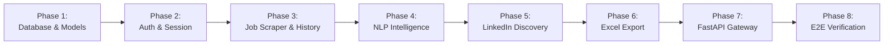

# Upwork Lead Intelligence & Discovery Platform
## Phased Implementation Plan

**Target Architecture:** FastAPI, Clean Architecture, Pydantic V2 Multi-Model, SQLAlchemy 2.0, Playwright, spaCy, SerpAPI, OpenPyXL  
**Date:** October 2026  
**Document:** `context/IMPLEMENTATION_PHASES.md`

---

## Roadmap Overview



---

## Phase 1: Foundation, Database & Pydantic Data Contracts

### Objective
Establish the project foundation, configure environment settings via `pydantic-settings`, initialize the relational database (SQLite local / PostgreSQL ready) with SQLAlchemy 2.0, and build the Pydantic V2 multi-model contracts (`Base`, `Create`, `Update`, `Response`).

### Key Deliverables
1. **Config & Settings:**
   * `app/config.py`: Centralized configuration (`DATABASE_URL`, `SERPAPI_KEY`, `SESSION_FILE_PATH`, rate-limit constants).
2. **Database Engine & Base:**
   * `app/models/base.py`: SQLAlchemy `DeclarativeBase` with timestamp mixins (`created_at`, `updated_at`).
   * `app/models/session.py`: Database connection factory (`async_sessionmaker`, SQLite WAL mode).
3. **Relational Table Models:**
   * `app/models/search_run.py`: `SearchRun` model.
   * `app/models/client.py`: `Client` model (location, spend, rating, hire stats).
   * `app/models/job.py`: `Job` model (budget, duration, proposal competition, description).
   * `app/models/contract.py`: `ClientContract` model (partitioned reviews, ratings, past titles).
   * `app/models/intelligence.py`: `ClientIntelligence` model (mined client/org, confidence, approval status).
   * `app/models/candidate.py`: `Candidate` model (rank, score, tier, is_primary_resolved, raw LinkedIn URL).
4. **Pydantic Schemas (`app/schemas/`):**
   * Multi-model schemas (`job.py`, `client.py`, `history.py`, `intelligence.py`, `candidate.py`).

### Verification Criteria
* Run database initialization script to create all tables and indexes.
* Execute unit tests verifying model relationships and Pydantic serialization.

```bash
.venv/bin/python -m pytest tests/test_database_models.py
```

---

## Phase 2: Upwork Authentication & Session Management

### Objective
Create an isolated, bot-evasive authentication service that manages Upwork login state, validates cookies, and handles session persistence securely.

### Key Deliverables
1. **Playwright Session Service (`app/services/auth_service.py`):**
   * Encapsulate Chrome launching with anti-detection flags (`--disable-blink-features=AutomationControlled`).
   * Load and save `storage_state` from `data/sessions/upwork_state.json`.
   * Implement automated login workflow with fallback for manual/interactive 2FA.
2. **Session Health Checker:**
   * Liveness probe that navigates to `https://www.upwork.com/nx/find-work/` to verify cookie validity and check for Cloudflare challenges.
3. **Session API Router (`app/api/v1/auth.py`):**
   * `POST /api/v1/auth/login`: Accepts credentials, logs in, and saves cookies.
   * `GET /api/v1/auth/status`: Returns session health (`AUTHENTICATED`, `EXPIRED`, `CHALLENGED`).

### Verification Criteria
* Login script successfully produces a valid `data/sessions/upwork_state.json`.
* Session probe returns `200 OK` on protected Upwork URLs without triggering Cloudflare blocks.

---

## Phase 3: Feed Scraping & Deep History Expansion Worker

### Objective
Build the core scraping service that searches Upwork feeds for keyword queries (e.g. `automation`, `ai ml`), captures the top 15–30 jobs, and deeply scrapes each job page by dynamically expanding all **30+ Client Recent History contracts**.

### Key Deliverables
1. **Search Feed Harvester (`app/services/scraper_service.py`):**
   * Query Upwork search feeds with URL parameters (`contractor_tier=1`, `sort=recency`).
   * Extract top 15–30 job cards into `Stage 1` JSON (`data/snapshots/stage1_feeds/`) and persist to `search_runs` & `jobs` tables.
2. **Deep Job Scraper & History Expansion Engine:**
   * Automated clicking of `Jobs in progress` button (`[data-cy='jobs-in-progress-button']`).
   * Repeatedly paginate through `View more` (`a:has-text('View more')`) in an asynchronous loop until all contracts (30–50 items) are rendered in the DOM.
3. **Strict Review Partitioning Parser:**
   * Implement the strict rule: isolate review text **strictly prior to `"To freelancer:"`**.
   * Discard all client feedback following `"To freelancer:"` from client identity processing.
   * Parse contract metadata: freelancer name, rating, budget, dates, active/completed status.
4. **Anti-Blocking Jitter Middleware (`app/core/rate_limiter.py`):**
   * Enforce random **8–15 second jitter** between sequential job navigations.
   * Snapshot-first caching to prevent redundant requests.

### Verification Criteria
* Navigate to live job `~022114892483288309550` and successfully expand and parse all 50 contracts into the database.
* Confirm that no praise directed at freelancers is stored as client review text.

---

## Phase 4: NLP Client & Organization Intelligence Engine

### Objective
Deploy spaCy NLP and linguistic pattern mining to accurately extract the true client's name from history reviews and the organization name from the job posting.

### Key Deliverables
1. **spaCy NLP Pipeline (`app/services/nlp_service.py`):**
   * Load `en_core_web_sm` model with entity recognition (`PERSON`, `ORG`).
   * Implement linguistic regex anchors for client names:
     * `(?:working with|worked with|with)\s+(?:Mr\.\s*)?([A-Z][a-z]+)`
     * `([A-Z][a-z]+)\s+is\s+(?:a|such|the|an)\s+client`
     * `([A-Z][a-z]+)\s+was\s+(?:great|excellent)`
   * Filter out grammatical stopwords and pronouns (`Him`, `Her`, `Them`, `You`).
2. **Company & Brand Extraction:**
   * Extract `ORG` entities from the job description and client past job titles.
   * Detect agency broker signals (`is_agency = TRUE` if broker language is detected).
3. **Human-in-the-Loop Review & Approval:**
   * `GET /api/v1/intelligence/{job_uid}`: Returns proposed client & company names with confidence scores and supporting text snippets.
   * `POST /api/v1/intelligence/confirm`: Allows the user to confirm, edit, or override the names before any search queries are executed.

### Verification Criteria
* Verify on job `~022114892483288309550` that `Yaniv` is extracted with 12 review confirmations and 0 false positives.

---

## Phase 5: LinkedIn Discovery & 4-Factor Scoring Service

### Objective
Integrate the LinkedIn GeoURN resolver, SerpAPI Google X-Ray search harvester, and the 4-factor scoring algorithm to deliver both **Primary Resolved Candidates** and **Potential Candidates**.

### Key Deliverables
1. **GeoURN Mapper (`app/services/geo_resolver_service.py`):**
   * Resolve location to country, US state, and metro URNs (e.g. Winnipeg: `90008587`, Canada: `101174742`).
   * Generate 3–4 precision in-app search links with encoded JSON array `geoUrn`.
2. **SerpAPI Harvester (`app/services/harvester_service.py`):**
   * Execute prioritized Google X-Ray searches (`site:linkedin.com/in/ "Name" "City" "Country"`).
   * Cache all SerpAPI JSON responses by MD5 query hash.
   * Parse organic results into `PersonCandidate` objects.
3. **4-Factor Composite Scoring Engine (`app/services/scorer_service.py`):**
   * **Name Match (40%):** Exact first name + initial / full name match.
   * **Location Match (35%):** Exact city, state, or country match.
   * **Role & Seniority (15%):** Decision-maker titles (CTO, CEO, Founder, Director).
   * **Company Alignment (10%):** Matches identified organization.
4. **Dual Candidate Delivery:**
   * Designate Rank #1 (Tier A) as `is_primary_resolved = TRUE`.
   * Record Rank #2..#10 as potential candidates (`is_primary_resolved = FALSE`).
   * Persist all scored candidates to `candidates` table.

### Verification Criteria
* Verify that SerpAPI discovers `Yaniv B.` (CTO at Tilt) as Tier A Resolved and `Yaniv Butorov` (U of Manitoba) as Tier B Potential.

---

## Phase 6: Dynamic 42-Column Master Excel Export Service

### Objective
Develop an OpenPyXL export engine that reads from the database and generates a sales-ready 42-column `.xlsx` workbook featuring raw, clickable links and organized into 6 functional zones.

### Key Deliverables
1. **Excel Generator (`app/services/excel_export_service.py`):**
   * Format the 6 zones:
     1. Opportunity & Deal Economics (Cols A–I)
     2. Competition & Outreach Urgency (Cols J–N)
     3. Client Credibility & Financial Power (Cols O–Y)
     4. Mined Client & Company Intelligence (Cols Z–AH)
     5. Direct LinkedIn Decision-Maker Outreach (Cols AI–AP)
     6. Sales Pitch Hooks & Technical Scope (Cols AQ–AS)
2. **Formatting & UX Rules:**
   * Raw, unmasked URLs in every link cell (`job_url`, `linkedin_profile_url`, `linkedin_search_url_metro`).
   * Auto-fit column widths (15–65 characters).
   * Tier color-coding (Green for Tier A, Yellow for Tier B, Gray for Tier C).
   * Fallback file saving to prevent crashes if a spreadsheet editor has locked the file.
3. **Dynamic Filter Querying:**
   * Query database dynamically based on query parameters (e.g., `min_spend`, `tier`, `country`).

### Verification Criteria
* Export `leads_decision_makers.xlsx` and verify with terminal viewer (`view_excel.py`) that all 42 columns render cleanly with raw URLs.

---

## Phase 7: FastAPI Application Gateway & Batch Pipeline Runner

### Objective
Tie all services together behind clean, asynchronous RESTful API endpoints and provide an autonomous batch execution runner.

### Key Deliverables
1. **FastAPI Application Factory (`app/main.py`):**
   * Lifespan context manager initializing database connection pools and Playwright browser instances.
   * Global exception handlers and structured request logging.
2. **API Routers (`app/api/v1/`):**
   * `auth.py`: Login and session management.
   * `jobs.py`: Search feed and job detail expansion.
   * `intelligence.py`: NLP entity discovery and human confirmation.
   * `leads.py`: LinkedIn candidate discovery, scoring, and Excel download.
   * `pipelines.py`: End-to-end batch processing (`POST /api/v1/pipelines/batch-run`).
3. **Background Batch Runner:**
   * Loop through the top 15–30 jobs, applying rate-limiting jitter (8–15s).
   * Automatically expand history, execute NLP extraction, harvest LinkedIn leads, and commit all stages to the database.

### Verification Criteria
* Launch FastAPI server (`uvicorn app.main:app`) and verify interactive Swagger UI at `/docs`.
* Trigger end-to-end pipeline run via API and verify database records and exported Excel.

---

## Phase 8: End-to-End Verification & Production Hardening

### Objective
Conduct rigorous regression testing, anti-blocking validation, error handling audits, and containerization.

### Key Deliverables
1. **End-to-End Automated Test Suite:**
   * Pytest integration tests covering the full pipeline from job URL to Excel export.
   * Fixture-backed mock tests for CI/CD runs without consuming SerpAPI credits.
2. **Anti-Blocking Verification:**
   * Test 15-job sequential scrape to ensure zero Cloudflare challenges or IP blocks.
   * Validate circuit breaker logic that halts execution if HTTP 403 or captcha is detected.
3. **Dockerization:**
   * `Dockerfile`: Multi-stage build with Python 3.12 and pre-installed Playwright Chromium dependencies.
   * `docker-compose.yml`: Services for FastAPI app, SQLite/PostgreSQL volume, and Celery/Redis worker (if needed).

---

## Summary of Phases & Timeline Estimate

| Phase | Description | Key Output |
| :---: | :--- | :--- |
| **Phase 1** | Foundation, Database & Schemas | SQLAlchemy models, SQLite/Postgres connection, Pydantic schemas |
| **Phase 2** | Auth & Session Management | Playwright session service, cookie health probe |
| **Phase 3** | Feed Scraping & 30+ History Expansion | Upwork job feed parser, interactive pagination loop, strict partitioner |
| **Phase 4** | spaCy NLP & Intelligence Service | Client & company name extractor, Human-in-the-Loop review API |
| **Phase 5** | LinkedIn Discovery & Scoring Engine | GeoURN resolver, SerpAPI harvester, 4-factor scoring (Resolved + Potential) |
| **Phase 6** | Master 42-Column Excel Generator | OpenPyXL raw URL report generator with 6 functional zones |
| **Phase 7** | FastAPI Gateway & Batch Pipelines | REST API endpoints, swagger docs, autonomous batch runner |
| **Phase 8** | E2E Verification & Dockerization | Full test suite, anti-blocking validation, Docker deployment setup |

