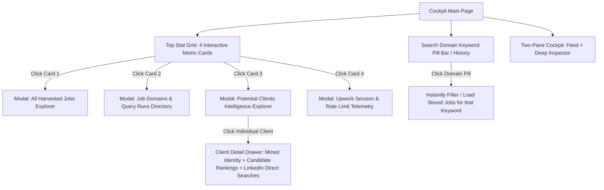

# Implementation Plan: Search Keyword Database Caching & Interactive Intelligence Dashboard

**Document Version:** 1.0  
**Target Architecture:** FastAPI (Port 8000) + PostgreSQL + React 18 / Vite / Tailwind / Framer Motion (Port 3000)  
**Strict Invariants:** Standard Python logging, Zero Emojis, 4-Color Palette (`#FBFCFC`, `#0F3D3E`, `#14746F`, `#8EB69B`).

---

## 1. Executive Summary & Core Objectives

This plan details the end-to-end design and implementation for three critical system enhancements:
1. **1-Hour Search Keyword Database Caching & Historical Run Tracking**:
   - Persist every search query and its extracted feed jobs into PostgreSQL under `search_runs`.
   - When a user repeats the same search keyword within 60 minutes, bypass scraping and instantly serve cached results directly from PostgreSQL with real-time TTL telemetry.
   - If repeated after 1 hour or forced via `force_live=true`, execute a fresh harvest, record a new `search_runs` row, and chronologically move older search runs downward.
2. **Interactive Search Domain & Keyword History Sidebar/Panel**:
   - A dedicated UI card and slide-over listing all domain queries executed across sessions.
   - Real-time badges for 1-hour active cache vs expired status.
   - Clicking any domain keyword instantly pulls all associated jobs from PostgreSQL.
3. **Interactive 4-Card Dashboard Metrics & Drill-Down Explorers**:
   - **Card 1: Harvested Jobs**: Total jobs in DB. Clicking opens a full-screen drawer displaying all harvested jobs across all queries, status (Stage 1 Feed vs Stage 2 Expanded), and quick actions.
   - **Card 2: Job Domains**: Total unique query domains executed. Clicking opens a domain breakdown with job counts and chronological query history.
   - **Card 3: Potential Clients**: Total clients discovered with mined intelligence. Clicking opens an interactive client directory displaying the job of origin, location, total spend, rating, and upon clicking an individual client, their discovered LinkedIn profiles, direct GeoURN queries, and scored candidates.
   - **Card 4: Rate Limit Health**: Live Upwork session health (`GREEN`, `YELLOW`, `RED`), cookie telemetry, and anti-blocking jitter state.

---

## 2. Color Palette & Visual Design Hierarchy

| Token Role | Hex Code | Visual Application |
| :--- | :--- | :--- |
| **Canvas / Light Surface** | `#FBFCFC` | Main background, clean white cards, modal backdrop |
| **Deep Forest Ink** | `#0F3D3E` | Primary headings, table text, dark-mode cards, solid brand buttons |
| **Teal Pine (Brand Accent)** | `#14746F` | Active tab indicators, primary action buttons, clickable keywords, links |
| **Sage Green (Tier / Status)** | `#8EB69B` | Borders, secondary badges, cache TTL countdowns, hover tints |
| **Sage Tint (Subtle Surface)** | `#E3F2ED` | Active card highlight, table row hover, callout backgrounds |
| **Dark Mode Canvas** | `#071E1F` | Deep dark mode background, high-contrast borders (`#1D4F50`) |

---

## 3. Database Schema Architecture

### 3.1 Enhanced `search_runs` Table
Add JSON results caching and query metadata to `app/models/search_run.py`:

```python
class SearchRun(Base):
    __tablename__ = "search_runs"

    search_query: Mapped[str] = mapped_column(String(100), index=True, nullable=False)
    target_limit: Mapped[int] = mapped_column(Integer, default=15, nullable=False)
    total_jobs_found: Mapped[int] = mapped_column(Integer, default=0, nullable=False)
    status: Mapped[str] = mapped_column(String(30), default="COMPLETED", nullable=False)

    # 1-Hour Cache Payload & Telemetry
    raw_jobs_payload: Mapped[Optional[List[dict]]] = mapped_column(
        JSON, nullable=True, default=list
    )
    is_cached_hit: Mapped[bool] = mapped_column(Boolean, default=False, nullable=False)

    # Relationships
    jobs: Mapped[List["Job"]] = relationship(
        "Job", back_populates="search_run", cascade="all, delete-orphan"
    )

    __table_args__ = (
        Index("idx_search_runs_query_created", "search_query", "created_at"),
        Index("idx_search_runs_created", "created_at"),
    )
```

### 3.2 Cache Query Invariant
```text
IF NOT force_live:
    latest_run = SELECT * FROM search_runs 
                 WHERE LOWER(search_query) = LOWER(:query) 
                   AND status = 'COMPLETED'
                 ORDER BY created_at DESC 
                 LIMIT 1;

    IF latest_run AND (NOW() - latest_run.created_at) < 3600 SECONDS:
        RETURN latest_run.raw_jobs_payload WITH:
            - is_cached = True
            - cached_at = latest_run.created_at
            - expires_in_seconds = 3600 - (NOW() - latest_run.created_at)
            - run_id = latest_run.id
```

---

## 4. Backend API Endpoints Design (`app/api/v1/`)

### 4.1 Search Feed with 1-Hour Smart Caching
- **`POST /api/v1/jobs/search`**
  - **Request**: `{ "query": "automation", "limit": 10, "force_live": false }`
  - **Behavior**:
    1. Checks DB for existing completed `search_runs` for `"automation"` within the past 1 hour.
    2. If valid cache exists, returns cached jobs instantly (< 25ms response time) with `cache_status: "HIT"`.
    3. If cache expired (> 60m) or `force_live: true`: launches scraper, creates new `search_runs` record, saves `raw_jobs_payload`, and returns fresh data.

### 4.2 Query Domains & History
- **`GET /api/v1/jobs/domains`**
  - Returns all search queries executed throughout the system:
    ```json
    [
      {
        "query": "automation",
        "latest_run_id": "9b1deb4d-3b7d-4bad-9bdd-2b0d7b3dcb6d",
        "latest_run_at": "2026-10-30T12:45:00Z",
        "total_jobs_found": 15,
        "total_runs_count": 3,
        "is_cache_active": true,
        "expires_in_minutes": 45
      }
    ]
    ```
- **`GET /api/v1/jobs/domains/{query}/history`**
  - Returns chronological list of all runs for this keyword (newest on top, older runs ordered downward).

### 4.3 Dashboard Aggregated Metrics & Drill-Downs
- **`GET /api/v1/jobs/dashboard/stats`**
  - Returns the 4 consolidated cockpit metrics:
    ```json
    {
      "harvested_jobs_count": 48,
      "unique_domains_count": 7,
      "potential_clients_count": 12,
      "rate_limit_health": "GREEN",
      "rate_limit_requests_remaining": 42,
      "active_session_cookies": 78
    }
    ```
- **`GET /api/v1/jobs/all`**
  - Returns all jobs saved in PostgreSQL with stage indicator (`FEED_CACHED` vs `STAGE2_EXPANDED`), client spending summary, and created timestamp.
- **`GET /api/v1/jobs/dashboard/clients`**
  - Returns all clients with mined intelligence:
    ```json
    [
      {
        "client_id": "...",
        "client_name": "Zarina",
        "company_name": "Mobile CRM Ltd",
        "target_role": "CTO",
        "origin_job": {
          "uid": "2116053989968212608",
          "title": "GoHighLevel & CRM Automation Specialist...",
          "posted_at": "2026-10-30T06:30:00Z"
        },
        "location": "Sydney, Australia",
        "total_spent_usd": 1700.00,
        "client_rating": "5.0",
        "total_hires": 120,
        "active_hires": 19,
        "discovered_candidates_count": 4,
        "tier_a_candidate": {
          "name": "Zarina M.",
          "headline": "Lead CRM Automation Specialist",
          "linkedin_url": "https://www.linkedin.com/in/zarina-example",
          "match_score": 86.5
        },
        "direct_search_urls_count": 5
      }
    ]
    ```

---

## 5. Frontend Component Hierarchy & User Experience



### 5.1 Interactive Dashboard Metric Cards (Top Bar)
1. **Harvested Jobs (`#14746F` accent)**:
   - Displays count (e.g. `48`).
   - Clicking opens **All Harvested Jobs Explorer** modal.
2. **Job Domains (`#0F3D3E` dark accent)**:
   - Displays unique keyword count (e.g. `7 Domains`).
   - Subtext shows *"Latest: automation (cached)"*.
   - Clicking opens **Job Domains Explorer**.
3. **Potential Clients (`#14746F` brand accent)**:
   - Displays identified clients count (e.g. `12 Clients`).
   - Subtext shows *"High-value decision makers"*.
   - Clicking opens **Potential Clients Intelligence Explorer**.
4. **Rate Limit Health (`#8EB69B` / Green badge)**:
   - Displays `GREEN` status and active cookie count.
   - Clicking opens **Session & Cookie Telemetry** dialog.

### 5.2 Search Keyword Domain Bar (`SearchDomainBar`)
- Placed directly beneath the search input.
- Displays query pills styled with `#FBFCFC` background and `#CCD9D3` border.
- **Active Cache Indicator**: Green dot + *"42m left"* if within 1 hour; gray dot + *"Expired"* if > 1 hour.
- **Micro-Interaction**: Clicking a pill triggers an immediate cache retrieval from DB without re-scraping Upwork.

### 5.3 Drill-Down Modal 1: Harvested Jobs Explorer
- Table view of all jobs in PostgreSQL:
  - Columns: Job Title, Job UID, Domain / Keyword, Client Location, Budget / Pay Type, Stage Status (Stage 1 vs Stage 2), Actions.
  - Action buttons: "Inspect in Cockpit", "Open on Upwork".

### 5.4 Drill-Down Modal 2: Job Domains Directory
- Grouped list of all queries executed:
  - Header: Domain name, run frequency, total jobs captured.
  - Sub-items: Chronological list of runs with timestamps.
  - Button: "Load Jobs from this Run" to display in main feed.

### 5.5 Drill-Down Modal 3: Potential Clients Intelligence Explorer
- High-density list of all clients identified so far:
  - Client Name (`Zarina`), Company (`Mobile CRM`), Target Role (`CTO`).
  - Origin Job Title and UID link.
  - Location badge (`Sydney, Australia`), Total Spent (`$1,700`), Rating (`5.0`), Total Hires (`120 / 19 active`).
  - **Click-to-Expand Client Profile**:
    - Slides open the verified candidates found for that client.
    - Tier A / B / C candidate cards with match score.
    - Clickable LinkedIn Direct GeoURN and Google X-Ray query buttons.

---

## 6. Implementation Phases & Step-by-Step Roadmap

| Phase | Target Area | Description | Deliverables |
| :--- | :--- | :--- | :--- |
| **Phase 1** | **Backend Database & Cache Logic** | Add `raw_jobs_payload` to `SearchRun` model, implement 1-hour cache lookup in `scraper_service.search_feed` | Updated ORM model, cache lookup logic in `scraper_service.py` |
| **Phase 2** | **Backend API Endpoints** | Build endpoints for `/jobs/domains`, `/jobs/dashboard/stats`, `/jobs/dashboard/clients`, and `/jobs/all` | New routes in `app/api/v1/jobs.py` and `app/api/v1/leads.py` |
| **Phase 3** | **Frontend Typed Services & Hooks** | Add API client methods and TanStack query hooks for domain history, dashboard stats, and client directory | Updated `api.ts`, new hooks `use-domains.ts`, `use-dashboard.ts` |
| **Phase 4** | **Frontend Interactive Metric Cards** | Replace static stat items in `App.tsx` with interactive clickable cards wired to drill-down modals | Refactored `stat-grid.tsx` with click handlers |
| **Phase 5** | **Frontend Drill-Down Modals** | Build `HarvestedJobsModal`, `DomainsDirectoryModal`, and `PotentialClientsModal` with deep client profile inspector | 3 new pattern components in `src/components/patterns/` |
| **Phase 6** | **Search Domain Pill Bar** | Add query history pill bar beneath search header with 1-hour active TTL status | New component `search-domain-bar.tsx` integrated into `App.tsx` |
| **Phase 7** | **Testing & Verification** | Unit tests for 1-hour DB cache, backend API endpoint tests, frontend build and test verification | Automated pytest tests + frontend node tests |

---

## 7. Verification Criteria & Success Metrics

1. **Cache Response Latency**:
   - Repeated search queries within 1 hour respond in `< 30ms` (served from PostgreSQL without opening Playwright or re-fetching).
   - `is_cached: true` flag and remaining TTL seconds clearly reported in API response and UI.
2. **Chronological Run Ordering**:
   - Queries older than 1 hour trigger a fresh scrape and append a new run; older runs remain accessible and ordered downward.
3. **Interactive Metric Cards**:
   - Clicking any of the 4 dashboard metric cards smoothly opens the respective drill-down modal with zero layout jumping.
4. **Client Intelligence Drill-Down**:
   - Clicking an individual client in the Potential Clients explorer displays their origin job, location, spend, rating, and all discovered candidate profiles with direct LinkedIn query action buttons.
5. **Code Quality Invariants**:
   - Zero emojis across all backend and frontend code, logs, and comments.
   - Python structured logging preserved.
   - Production build passes with 0 TypeScript and lint errors.

