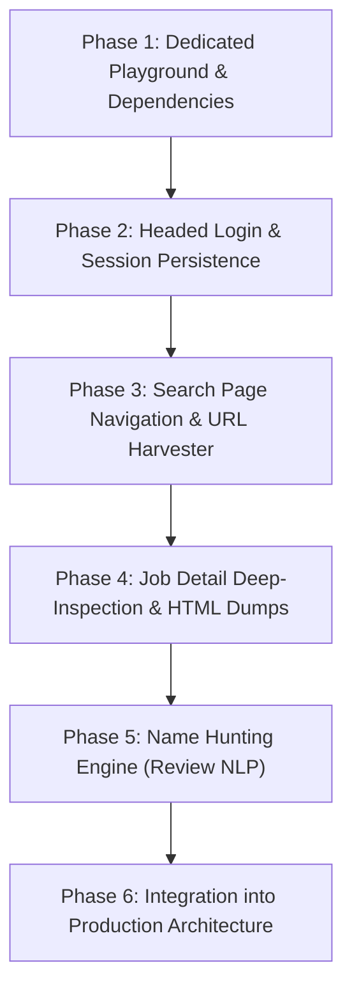

# Phase-Wise Plan: Interactive Test-Driven Upwork Scraper & Client Intelligence

## 1. Overview & Strategy

Rather than building a rigid monolithic system upfront, we will use an **interactive, test-driven playground (`playground/`)**. In this environment, we write lightweight, step-by-step test scripts that inspect live DOM structures, capture raw HTML snapshots, and verify selectors with you directly against real Upwork URLs.

A primary breakthrough highlighted in your example is that **freelancer reviews in the "Client's recent history" section often address the client by their real first and last name** (e.g., *"Robin Currie is a gentleman..."*). This provides a high-confidence identity anchor even when Upwork hides the client's name on the main job post.

---

## 2. Target Fields Inventory

| Category | Specific Target Fields | Key Value / Why It Matters |
|---|---|---|
| **Core Job Specs** | Title, Description, Job URL, Job ID (`~02...`), Category | Basic job context |
| **Pricing & Terms** | Budget Type (`Fixed` or `Hourly`), Budget Range / Hourly Rate, Project Duration, Hours/Week | Filter out low-budget / unsuitable jobs |
| **Experience & Fit** | Experience level (`Entry`, `Intermediate`, `Expert`), Skills tags | Match your company's skillset |
| **Job Activity** | Proposals range (e.g., `5 to 10`, `20 to 50`), Last viewed by client, Interviewing count, Invites sent, Unanswered invites | Measure competition and lead freshness |
| **About the Client** | Country, City, Client Local Time, Total Spent (e.g., `$50K+`), Jobs Posted, Hire Rate %, Open Jobs, Member Since, Payment Verification Status | Compute Client Quality Score & qualification |
| **Client Recent History** | Past/Active job titles, ratings given & received, feedback text, billed amounts | High-intent signals & historical hiring behavior |
| **Review Intelligence (Goldmine)** | **Freelancer reviews addressed to the client** | **Extract candidate personal name (e.g., "Robin Currie", "John was great...")** |
| **Hidden Hints** | Company name hints in descriptions, email signatures, company website links | Additional identity clues for lead matching |

---

## 3. Phase-by-Phase Implementation Plan

### Phase 1: Environment & Dedicated Test Playground
- **Goal:** Set up a clean working directory (`playground/`) and verify Python runtime + browser dependencies (Playwright, BeautifulSoup4/Selectolax).
- **Deliverables:**
  - `playground/` directory created.
  - Required packages installed in venv (`playwright`, `selectolax`, `pydantic`, `rich`).
  - Chromium browser binary installed for Playwright.

### Phase 2: Live Session Capture (`playground/01_save_session.py`)
- **Goal:** Allow you to log in cleanly once with full human verification (2FA/CAPTCHA) and save cookies & storage state.
- **Action:**
  - Launch a visible (headed) Chromium window targeting `https://www.upwork.com/ab/account-security/login`.
  - Pause and wait for you to log in and reach the dashboard.
  - Save `storage_state` to `secrets/upwork_state.json` (git-ignored).
  - Verify session restoration in a subsequent headless test.

### Phase 3: Search Page Navigation & Harvester (`playground/02_test_search.py`)
- **Goal:** Navigate to the search URL (e.g., `https://www.upwork.com/nx/search/jobs/?q=automation`) using the saved session.
- **Action:**
  - Load session state and navigate to search page with realistic headers and browser parameters.
  - Inspect the job list cards and extract:
    - Job Title
    - Job detail modal/page URL (`/nx/search/jobs/details/~...`)
    - Quick card stats (posted time, snippet, budget)
  - Save raw HTML of a search page to `playground/fixtures/search_page.html` for offline unit testing without burning page views.

### Phase 4: Job Detail Deep-Inspection (`playground/03_inspect_job_details.py`)
- **Goal:** Open target job detail URLs/modals (e.g., `https://www.upwork.com/nx/search/jobs/details/~022115295609736866961...`).
- **Action:**
  - Target the specific modal/slider or standalone detail page.
  - Locate and extract:
    1. **Price & Level**: Hourly/fixed budget, experience tier.
    2. **Activity on this job**: Proposals count, interviewing, invites.
    3. **About the client**: Location, local time, spend, hire rate, ratings.
    4. **Client's recent history section**: Expand "Client's recent history", iterate through items (both "Jobs in progress" and "Completed jobs").
  - Dump raw job HTML to `playground/fixtures/sample_job_details.html` so we can inspect every selector interactively with you.

### Phase 5: Client Name Hunting & Review Intelligence (`playground/04_extract_client_name.py`)
- **Goal:** Turn freelancer review text into extracted client names with confidence scoring.
- **Action:**
  - Parse freelancer feedback blocks (e.g., *"Robin Currie is a gentleman and easy to communicate with..."*).
  - Apply linguistic and NLP patterns:
    - Named Entity Recognition (NER) / capitalized person names at the start of feedback sentences.
    - Common phrasing patterns: `"[Name] is a pleasure to work with"`, `"Thanks [Name]!"`, `"Working with [Name] was..."`.
    - Cross-validation: Check if the same name appears across multiple independent freelancer reviews. If 3 freelancers mention "Robin", confidence reaches near 100%.
  - Associate the detected name with source proof (`"Found in review for job: DNS, Porkbun..."`).

### Phase 6: Production Consolidation (`src/lead_agent/...`)
- **Goal:** Port the verified playground selectors and extraction logic into the modular production pipeline defined in `AGENT_BRIEF.md`.
- **Action:**
  - Put verified selectors in `sources/upwork/selectors.py`.
  - Put parser in `sources/upwork/parse_job.py`.
  - Wire output to `ClientLead` (with `lead_type = NAMED` when review name is found).
  - Hook into candidate enrichment & scoring.

---

## 4. Key Questions & Verifications

1. **Browser Preference**: Are you comfortable having Playwright launch a regular visible Chrome/Chromium window on your local machine for the one-time login step?
2. **Modal vs. Direct URL**: In Upwork, jobs can open as a slide-out modal or as a direct page (`https://www.upwork.com/jobs/~02...`). We can target direct URLs to make extraction cleaner and faster.
